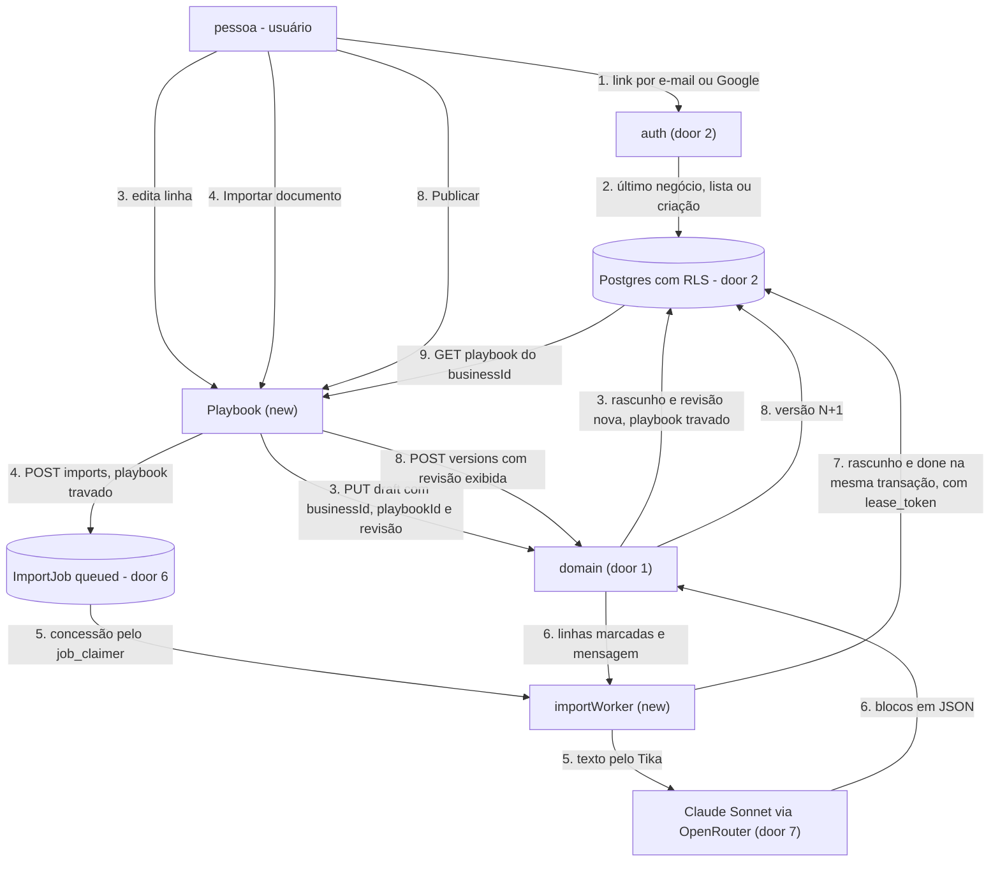
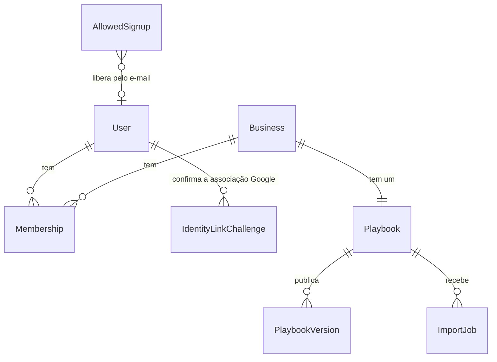
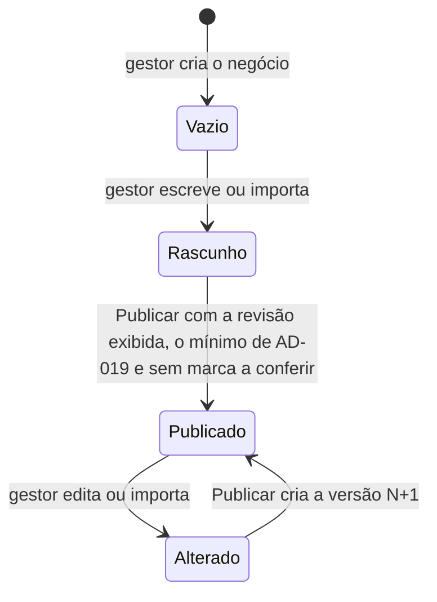
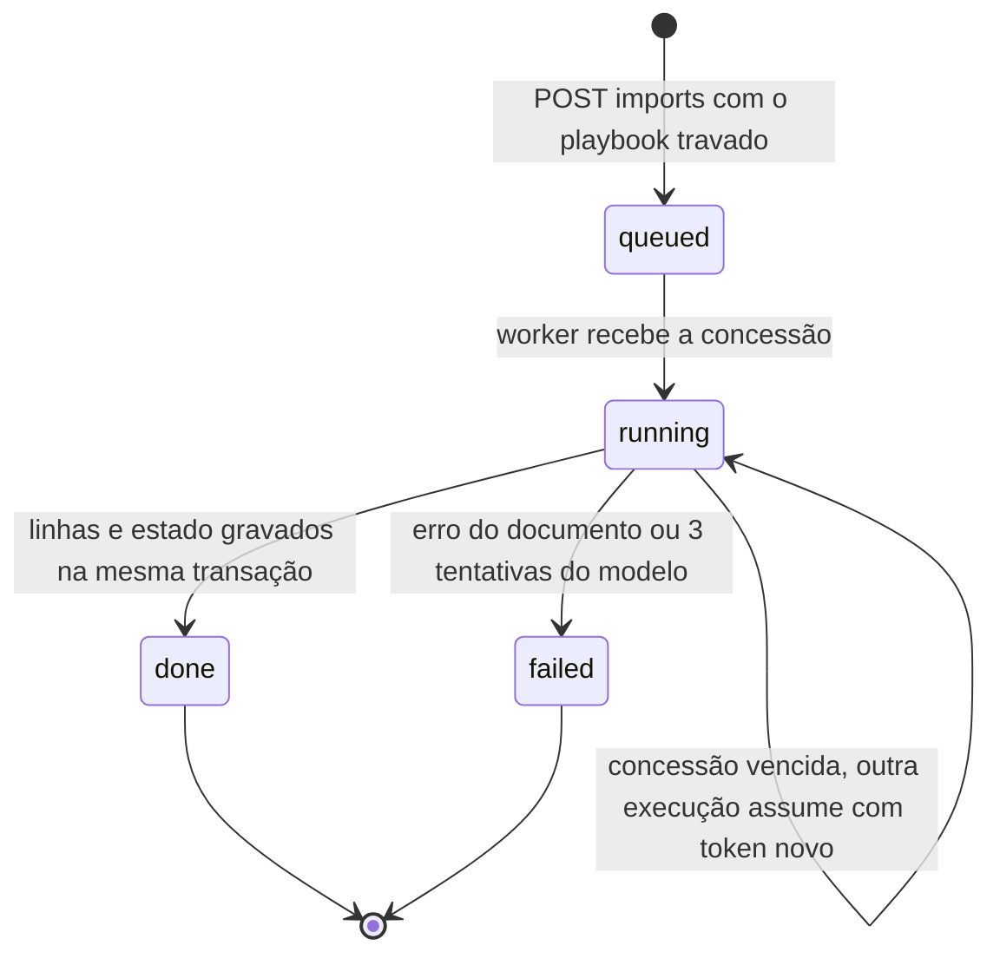
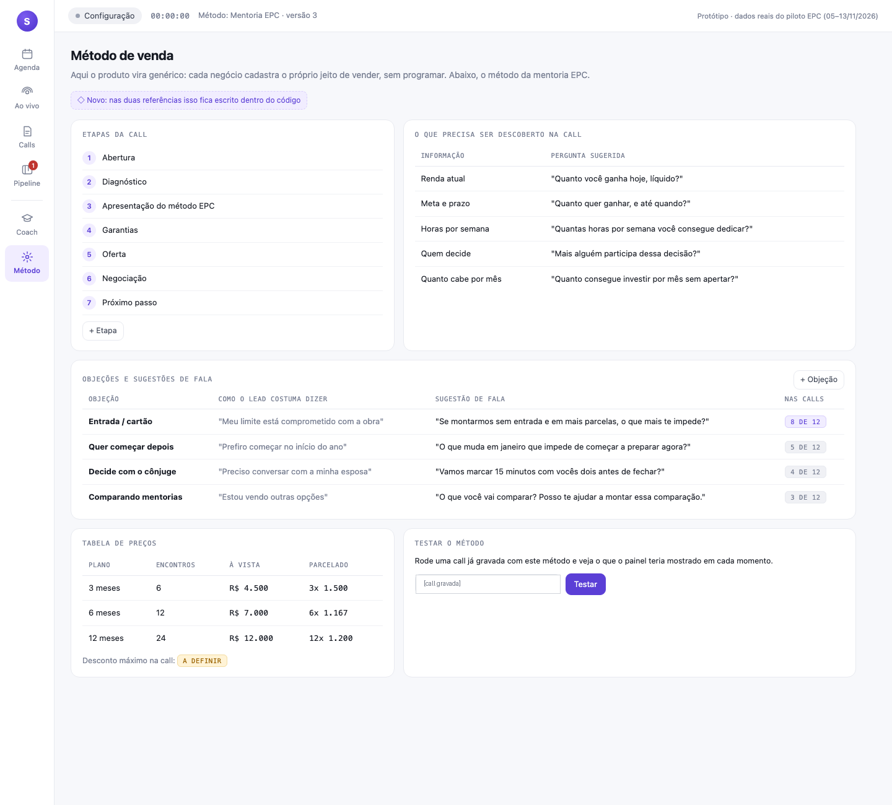

# Playbook configurável

**Approved**: 2026-11-15 - user: "aprovo o plano da parte 1"

> Build this with **tlc-implement**. Every criterion becomes a check with a proof; nothing under
> the open questions is settled while building.

## Problem

O dono ou gestor de vendas de um negócio de venda consultiva não consegue pôr o próprio playbook numa ferramenta sem programar. No playbook-sales-copilot, cujo código foi lido, etapas, perguntas, objeções e oferta ficam escritas no código. No Deal Advisor, de código fechado, o vídeo analisado mostra um produto preso a um único negócio, sem configuração de playbook visível. Sem o playbook dentro do produto, a ajuda ao vivo, o fim da call e o treino das partes seguintes não têm o que mostrar ao closer, e cada negócio novo exigiria alguém que programe. Evidência: as análises das duas referências em `pesquisas/`; o PRD não mede o custo fora disso.

Quando esta parte estiver pronta, o gestor de um negócio liberado entra no produto, escreve ou importa de um documento as etapas da call, o que descobrir com a pergunta sugerida, as objeções com a resposta aprovada e a tabela de preços com desconto máximo, confere os preços importados, edita tudo na tela e publica uma versão, sem escrever uma linha de código.

## Shape

O projeto não tem código; esta parte cria a base que as outras quatro reaproveitam: as pastas `server/`, `web/` e `deploy/` (AD-034), o isolamento por negócio no Postgres com RLS (AD-004, AD-037), o login e a sessão (AD-022, AD-039, AD-047, AD-048), o negócio no endereço de cada comando e o cadastro fechado (AD-041, AD-045), a fila de tarefas com concessão e privilégio próprio (AD-032, AD-038, AD-049), a trava comum de concorrência (AD-050) e o documento do playbook com revisão e versões imutáveis (AD-023, AD-024, AD-036, AD-046). As regras que mudam o que o gestor vê (validação de cada linha, o mínimo para publicar, as marcas de conferência, o que a importação aceita, o descarte de preço fora do texto, os conflitos de importação, a autoridade do Google sobre o e-mail) ficam no módulo de domínio do servidor, sem dependência de web nem de banco, testado com JUnit; a formatação de dinheiro, as colunas que aparecem e o bloqueio de "Publicar" com alteração não salva ficam no app web, testados com Vitest; o acesso ao banco, o RLS, a concessão de tarefas e as disputas entre transações são testados com Testcontainers e Postgres real.

1. pessoa usa o link por e-mail ou "Entrar com Google" em `/entrar` -> `auth` (door 2) - o link abre `/entrar/link` e só o botão "Entrar" consome o token; o Google entra direto quando é autoridade sobre o e-mail e, nos outros casos, grava um desafio de associação e manda um link próprio dele, que é a única forma de ligar a identidade; a sessão fica no Postgres
2. `auth` (door 2) - `memberships`, filtrada por `app.user_id`, devolve os negócios da pessoa; com o último negócio usado ainda válido ou com um só, abre `/n/<businessId>/playbook`; com mais de um, mostra a lista; sem nenhum, `allowed_signups` decide entre o formulário de criação e "Seu acesso ainda não foi liberado."; a criação trava a linha da pessoa em `users` e grava `Business`, `Membership` com papel `gestor` e `Playbook` com rascunho vazio na mesma transação (doors 2 e 3)
3. gestor edita uma linha na tela `Playbook` (new) -> `PUT /api/businesses/{businessId}/playbook/draft` com `playbookId` e revisão - o servidor confere a associação, define `app.business_id`, trava a linha do playbook, confere `playbookId`, revisão e importação ativa, e `domain` (door 1) valida o rascunho inteiro; persiste `Playbook.draft` com a revisão nova (door 3)
4. gestor usa "Importar documento" com arquivo, texto colado ou link do Google Docs -> `POST /api/businesses/{businessId}/playbook/imports` - o servidor trava a linha do playbook, confere formato e tamanho, grava o arquivo no volume da VPS (AD-028) e persiste `ImportJob` em `queued` (door 6); responde 202, e o rascunho fica só para leitura
5. `importWorker` (new) - pega a próxima tarefa pela função de concessão do papel `job_claimer` (door 6), define `app.business_id`, extrai o texto com Apache Tika (AD-027) e pede ao Claude Sonnet, pelo OpenRouter com `zdr: true` (AD-007), os blocos em JSON no schema do playbook
6. `domain` (door 1) - valida o JSON devolvido, descarta valor em dinheiro que não aparece no texto, marca planos e desconto importados com "Importado · conferir" e o trecho de origem, preenche desconto e nome da coluna só se vazios e monta a mensagem do resultado (AD-017, AD-035)
7. `importWorker` (new) - numa transação, trava o playbook, acrescenta as linhas ao rascunho, incrementa a revisão e marca a tarefa `done` ou `failed`, tudo condicionado ao `lease_token` (door 6); depois do commit, apaga o arquivo
8. gestor usa "Publicar" -> `POST /api/businesses/{businessId}/playbook/versions` com `playbookId` e a revisão exibida -> o servidor trava a linha do playbook e confere a revisão; `domain` (door 1) confere o mínimo de AD-019, as linhas completas, o desconto máximo e a ausência de marca "Importado · conferir"; persiste `PlaybookVersion` N+1, imutável (door 4)
9. out: a tela mostra "Playbook: <nome> · versão <N>" e o estado da importação lido em `GET /api/businesses/{businessId}/playbook`; as partes 2 a 5 leem a última `PlaybookVersion` (fora deste plano)

**Changes underneath**

| Front | What changes |
| --- | --- |
| domain | termos novos: `Playbook` (o jeito de vender de um negócio, um por negócio), `Rascunho` (o conteúdo editável, com revisão, que não chega a call nenhuma), `Versão` (cópia imutável do rascunho no momento de "Publicar", a única que vale para o resto do produto) e `Último negócio usado` (só decide onde a pessoa cai ao entrar; cada comando leva o próprio negócio no endereço) - ninguém ramifica neles hoje |
| stored data | nada a migrar - não existe banco |
| readers | as partes 2 a 5 leem a última versão publicada; nenhuma existe ainda (Out of scope) |

New: `User`, `AllowedSignup`, `IdentityLinkChallenge`, `Business`, `Membership`, `Playbook`, `PlaybookVersion` e `ImportJob`, e todas as relações acima, mais as tabelas de sessão e de token de login do Spring. One-way constraints: `business_id` não nulo com RLS forçado em toda tabela de negócio (door 2); `Playbook` único por `business_id` e `unique(id, business_id)` com chave estrangeira composta nas tabelas filhas (doors 2 e 3); `(playbook_id, number)` único e versão sem update nem delete (door 4); dinheiro como decimal exato (door 5); no máximo uma `ImportJob` `queued` ou `running` por playbook (door 6); cada item do playbook com `id` estável entre rascunho e versões (door 3).

## Surface

Rotas do servidor Spring consumidas pelo app web. Toda resposta de erro segue a RFC 9457 (AD-057): `application/problem+json` com `type`, `title`, `status`, `detail` e `instance`, mais as extensões `code` e, quando o erro é de campo, `errors` como lista de `{itemId, field, code, message}`. Quem não tem sessão recebe `401`; quem não é membro do `businessId` do endereço recebe `404`; quem é membro mas não é `gestor` recebe `403` nas rotas de escrita; um `playbookId` que não pertence ao `businessId` recebe `404`. Rotas de escrita exigem o token CSRF.

| Route | In | Out | Status | Who |
| --- | --- | --- | --- | --- |
| `GET /oauth2/authorization/google` | - | redireciona ao Google | `302` | qualquer pessoa |
| `POST /ott/generate` | `{username}` (e-mail) | a mesma resposta para qualquer e-mail | `200`, `403` sem token CSRF, `429` `too_many_requests` | qualquer pessoa com o token CSRF da página `/entrar` |
| `GET /api/login-links/{token}` | token do link, sem consumir | `{email}` para a página "Entrar como <e-mail>?" | `200`, `404` `invalid_token` | quem recebeu o link |
| `POST /login/ott` | `token` (formulário) | consome o token, cria a sessão e redireciona ao produto | `302`, `401` `invalid_token`, `403` sem token CSRF | quem recebeu o link |
| `GET /api/identity-links/{token}` | token do desafio de associação, sem consumir | `{email}` para a página "Entrar como <e-mail>?" | `200`, `404` `invalid_token` | quem recebeu o link de associação |
| `POST /login/identity-link` | `token` (formulário) | consome o desafio, grava o `google_subject` no usuário, cria a sessão e redireciona ao produto | `302`, `401` `invalid_token`, `403` sem token CSRF | quem recebeu o link de associação |
| `POST /logout` | - | - | `204`, `401` sem sessão, `403` sem token CSRF | quem tem sessão |
| `GET /api/me` | - | `{user: {email}, businesses: [{id, name, role}], lastBusinessId or null, canCreateBusiness}` | `200`, `401` | qualquer pessoa com sessão |
| `POST /api/businesses` | `{businessName, playbookName}` | `{businessId}` | `201`, `401`, `403` `signup_not_allowed`, `409` `already_member`, `422` | quem tem sessão, e-mail liberado em `allowed_signups` e nenhuma associação |
| `GET /api/businesses/{businessId}/playbook` | - | `{playbookId, name, draft, revision, latestVersion: {number, publishedAt} or null, hasUnpublishedChanges, hasCalls, importJob: {id, status, counts, skipped, notices, errorCode} or null}` | `200`, `401`, `404` | membro do negócio |
| `PUT /api/businesses/{businessId}/playbook/draft` | `{playbookId, draft, revision}` (documento inteiro, AD-023) | `{draft, revision}` | `200`, `401`, `403`, `404`, `409` `revision_conflict` / `import_running`, `422` | `gestor` do negócio |
| `POST /api/businesses/{businessId}/playbook/versions` | `{playbookId, revision}` | `{number}` | `201`, `401`, `403`, `404`, `409` `revision_conflict` / `nothing_to_publish` / `import_running`, `422` `publish_minimum` / `incomplete_rows` / `discount_invalid` / `pending_review` | `gestor` do negócio |
| `POST /api/businesses/{businessId}/playbook/imports` | `playbookId` e multipart `file`, ou `{playbookId, text}`, ou `{playbookId, googleDocsUrl}` | `{jobId}` | `202`, `401`, `403`, `404`, `409` `import_running`, `413` `file_too_large`, `415` `unsupported_format`, `422` | `gestor` do negócio |

## Landing

| One-way door | Literal shape | Alternative rejected |
| --- | --- | --- |
| 1. pastas, fatias e módulo de regras | `server/` gerado pelo Spring Initializr, com Java 25, Spring Boot 4.1, Spring AI 2.0.1 e Maven Wrapper (AD-002, AD-029); `web/` gerado pelo `create-vue`, com Vue 3, Vite, Tailwind v4 e shadcn-vue, pnpm (AD-003); `deploy/` com Docker Compose (Postgres, servidor, Caddy) e `Caddyfile` (AD-033); no servidor, um módulo por fatia (`auth`, `business`, `playbook`, `importing`), cada um com `api/` como única entrada pública, `domain/` com as decisões puras, que não importa Spring Web, JPA nem JDBC, e os internos lado a lado, e um teste do Spring Modulith que falha quando um módulo usa o interno de outro (AD-053, AD-055); `Makefile` na raiz com `make check` e `make doctor` (AD-056); no app web, `src/features/<fatia>/` e `src/components/ui/` para o shadcn-vue (AD-054) | regras nos controllers - ficariam fora do alcance dos testes de unidade e se espalhariam pelas partes 2 a 5; camadas globais - cada parte nova espalharia arquivos por quatro pastas |
| 2. isolamento, login e sessão | tabelas `users(id, email unique, google_subject unique null)`, `allowed_signups(email primary key)`, `identity_link_challenges(id, token_hash unique, email, google_subject, expires_at, consumed_at null)`, `businesses(id, name)` e `memberships(user_id, business_id, role)` com `role in ('gestor','closer')`; papel `migrator` dono das tabelas e usado pelo Flyway (AD-030); papel `app` sem posse, sem `BYPASSRLS`, só leitura em `allowed_signups`; `users`, `allowed_signups` e `identity_link_challenges` sem RLS e usadas só pelo login; `memberships` com política `user_id = current_setting('app.user_id')::uuid`; toda tabela de negócio com `business_id uuid not null`, `ENABLE` e `FORCE ROW LEVEL SECURITY` e política `business_id = current_setting('app.business_id')::uuid`; cada transação começa com `SET LOCAL app.user_id` e `SET LOCAL app.business_id` do `businessId` do endereço, depois de conferir a associação; a sessão guarda o usuário e o último negócio usado; tabelas do Spring Session JDBC e do `JdbcOneTimeTokenService`; o Google é autoridade sobre o e-mail só com `@gmail.com` ou claim `hd`, e nos outros casos grava um desafio em `identity_link_challenges` com o e-mail e o `google_subject` daquela tentativa, válido por 15 minutos, e manda um link próprio desse desafio; só `POST /login/identity-link` consome o desafio, com `UPDATE ... SET consumed_at = now() WHERE token_hash = ? AND consumed_at IS NULL AND expires_at > now() RETURNING email, google_subject` e a gravação do `google_subject` em `users` na mesma transação; o login comum por link (`JdbcOneTimeTokenService`) nunca lê nem consome desafios (AD-037, AD-039, AD-041, AD-045, AD-047, AD-048, AD-052) | negócio ativo na sessão - uma aba que troca de negócio desviaria a gravação de outra aba; filtro por `business_id` só nas consultas - uma consulta esquecida mostra dados de outro negócio, contra a regra 8; sessão em memória - um reinício deslogaria todos |
| 3. documento do playbook e concorrência | `playbooks(id, business_id, name, draft jsonb not null, draft_revision bigint not null, updated_at)` com `unique(business_id)` e `unique(id, business_id)`; `draft` com `schemaVersion: 1` e quatro listas ordenadas: `stages[{id, name}]`, `discovery[{id, information, question}]`, `objections[{id, name, leadSays, approvedResponse}]`, `priceTable{extraColumnName, maxDiscount, maxDiscountReview, plans[{id, name, extraValue, cash, installments: {count, value} or null, review}]}`, em que `review` e `maxDiscountReview` são `{status: "pending", excerpt}` ou `null`; `id` é UUID gerado na criação do item e mantido em todas as versões; gravar, publicar, enfileirar e concluir importação começam com `SELECT ... FROM playbooks WHERE id = ? FOR UPDATE`, e a criação de negócio começa com `SELECT ... FROM users WHERE id = ? FOR UPDATE` (AD-023, AD-035, AD-036, AD-050) | tabelas por bloco - publicar copiaria quatro tabelas; ids por posição - as partes 2 a 4 contam objeções e dicas por item entre versões; conferir sem travar - duas transações passariam pela mesma verificação |
| 4. versões | `playbook_versions(id, playbook_id, business_id, number int, content jsonb, published_at, published_by)`, `unique(playbook_id, number)`, `number` começa em 1, chave estrangeira `(playbook_id, business_id)`; o papel `app` não tem `UPDATE` nem `DELETE` nessa tabela (AD-024) | versão editável - uma call apontaria para um conteúdo que mudou depois |
| 5. dinheiro | `BigDecimal` com escala 2 no servidor; dentro do JSONB, string decimal com duas casas e ponto (`"4500.00"`); colunas de dinheiro fora do JSONB, nas partes seguintes, `numeric(12,2)` (AD-025) | número JSON - o JavaScript do app web o leria como ponto flutuante |
| 6. fila de importação | `import_jobs(id, business_id, playbook_id, status, source_kind, file_path null, attempts, lease_token null, lease_expires_at null, counts jsonb null, skipped int, notices jsonb null, error_code null, created_at, finished_at null)` com `status in ('queued','running','done','failed')`, chave estrangeira `(playbook_id, business_id)` e índice único parcial em `playbook_id` onde `status in ('queued','running')`; papel `job_claimer` sem login, dono de `claim_next_import_job()`, com só `SELECT` e `UPDATE` em `import_jobs` e política `to job_claimer using (true) with check (true)`; a função tem `SECURITY DEFINER`, `SET search_path = pg_catalog, <schema do produto>`, `REVOKE EXECUTE ... FROM PUBLIC` e `GRANT EXECUTE` só ao `app`, usa `FOR UPDATE SKIP LOCKED` sobre tarefa `queued` ou `running` com concessão vencida e devolve só `(job_id, business_id, lease_token)`; toda escrita do worker tem `where lease_token = ?` (AD-032, AD-038, AD-049) | RabbitMQ - o estado ficaria no Postgres de qualquer forma e gravar e enfileirar exigiria outbox; função do `migrator` - com `FORCE ROW LEVEL SECURITY` continuaria presa ao negócio da sessão; `BYPASSRLS` - abriria todas as tabelas ao dono da função |
| 7. chamada ao modelo na importação | Spring AI com o cliente compatível com OpenAI apontado para o OpenRouter, modelo Claude Sonnet, corpo da requisição com `provider: {zdr: true}`; se o cliente do Spring AI não enviar esse campo, a chamada usa um cliente HTTP próprio com o mesmo corpo (AD-007) | API da Anthropic direto - escolhida só para a call ao vivo |
| 8. dependências | Apache Tika 3 (AD-027), Spring Security com login OAuth2 e login por token de uso único (AD-022), Spring Session JDBC (AD-039), Spring Mail por SMTP (AD-031), Flyway, Testcontainers, Vitest e Playwright | - |
| 9. limite de pedidos de link | tabela `login_link_requests(email primary key, requested_at)`, sem RLS e usada só pelo login; o filtro antes de `POST /ott/generate` trava a linha do e-mail (`FOR UPDATE`) e recusa com `429` se o último pedido tem menos de 60 segundos (AD-039) | contador em memória - dois servidores ou um reinício perderiam a contagem |
| 10. origem da importação do Google Docs | coluna `import_jobs.source_url text null`, com o link enviado pelo gestor; o servidor só aceita `https://docs.google.com/document/d/<id>` e monta ele mesmo a URL de exportação (AD-027) | guardar o link num arquivo do volume - o arquivo da tarefa é apagado ao terminar, e o link precisa sobreviver a uma nova tentativa |
| 11. estado das tarefas para a varredura | função `import_job_statuses(job_ids uuid[])` com `SECURITY DEFINER`, dona `job_claimer`, `search_path` fixo, execução só do `app`, devolvendo `(job_id, status)` (AD-038, AD-049) | varredura sob RLS - não enxergaria as tarefas de outros negócios e apagaria arquivos de tarefas em andamento |

- Nothing else in this change is hard to reverse

## Criteria

### S1: A pessoa entra e chega ao negócio certo (P1)

A pessoa entra com o link por e-mail ou com Google e chega ao playbook do negócio que escolheu; quem não foi liberado não cria negócio, e nenhum comando age num negócio diferente do que a tela mostra.

**Acceptance Criteria**

1. WHEN uma pessoa sem sessão abre qualquer tela do produto THEN the system SHALL redirecionar para `/entrar`, com "Entrar com Google" e o campo de e-mail para receber o link de acesso
2. WHEN a pessoa informa um e-mail em `/entrar` THEN the system SHALL enviar o link de acesso por SMTP e mostrar "Enviamos um link de acesso para <e-mail>.", com a mesma resposta para e-mail cadastrado ou não
   - e-mail sem "@" → "Informe um e-mail válido." e nada é enviado
3. IF o mesmo e-mail pede outro link em menos de 60 segundos THEN the system SHALL responder `429` `too_many_requests`, não enviar e-mail e mostrar "Aguarde 1 minuto para pedir outro link."
4. WHEN a pessoa abre o link do e-mail THEN the system SHALL mostrar em `/entrar/link` "Entrar como <e-mail>?" com o botão "Entrar", sem consumir o token
   - abrir o link duas vezes e depois usar "Entrar" → entra
5. WHEN a pessoa usa "Entrar" na página do link THEN the system SHALL consumir o token em `POST /login/ott` e criar a sessão
6. IF o token do link já foi consumido ou tem mais de 15 minutos THEN the system SHALL não criar sessão e mostrar "Este link já foi usado ou expirou. Peça um novo."
   - "Entrar" aos 14 minutos → entra; o mesmo link de novo → recusado; link novo usado aos 16 minutos → recusado
7. IF a conta Google não tem o e-mail verificado THEN the system SHALL não criar sessão e mostrar "Seu e-mail do Google não está verificado."
8. WHEN uma pessoa entra com Google e o Google é autoridade sobre o e-mail (endereço `@gmail.com` ou claim `hd`) THEN the system SHALL entrar no usuário com aquele `google_subject` ou, se não houver, no usuário com aquele e-mail, gravando nele o `google_subject`
9. IF uma pessoa entra com Google pela primeira vez e o Google não é autoridade sobre o e-mail THEN the system SHALL não criar sessão, não ligar a identidade nem consultar `allowed_signups`, gravar um desafio de associação com o e-mail e o `google_subject` daquela tentativa, válido por 15 minutos, enviar ao e-mail o link desse desafio e mostrar "Confirme seu e-mail: enviamos um link para <e-mail>."
   - `ana@gmail.com` → entra direto; `ana@empresa.com.br` com `hd` → entra direto; `ana@empresa.com.br` sem `hd` → desafio e link de associação
10. WHEN a pessoa abre o link de associação e usa "Entrar" na página "Entrar como <e-mail>?" THEN the system SHALL consumir o desafio e gravar o `google_subject` dele no usuário daquele e-mail na mesma transação, criar a sessão, e os logins seguintes com essa conta Google SHALL entrar direto
   - dois "Entrar" simultâneos com o mesmo desafio → um entra e grava; o outro recebe "Este link já foi usado ou expirou. Peça um novo."
11. IF a pessoa usa um link de login comum para o mesmo e-mail, ou um desafio de associação já consumido ou com mais de 15 minutos THEN the system SHALL não gravar `google_subject` nenhum; o link comum SHALL só criar a sessão, e o desafio recusado SHALL mostrar "Este link já foi usado ou expirou. Peça um novo."
   - tentativa Google gera o desafio D; a pessoa pede um link comum e entra por ele → sessão criada, `users.google_subject` continua vazio e D continua pendente; D usado aos 16 minutos → recusado, nada gravado
12. WHEN uma pessoa autenticada sem associação tem o e-mail em `allowed_signups` THEN the system SHALL pedir o nome do negócio e o nome do playbook, ambos obrigatórios com 1 a 80 caracteres, e ao confirmar SHALL criar o negócio com essa pessoa como `gestor` e abrir `/n/<businessId>/playbook`
13. IF uma pessoa autenticada sem associação não tem o e-mail em `allowed_signups` THEN the system SHALL mostrar "Seu acesso ainda não foi liberado." e `POST /api/businesses` SHALL responder `403` `signup_not_allowed` sem criar nada
14. IF uma pessoa que já é membro de algum negócio chama `POST /api/businesses` THEN the system SHALL responder `409` `already_member` e não criar nada
15. IF a mesma pessoa envia dois `POST /api/businesses` ao mesmo tempo THEN the system SHALL criar exatamente um negócio e responder `409` `already_member` ao outro
16. WHEN uma pessoa entra e o último negócio usado ainda a tem como membro, ou ela é membro de um negócio só THEN the system SHALL abrir `/n/<businessId>/playbook` desse negócio
17. WHEN uma pessoa membro de mais de um negócio entra sem último negócio válido THEN the system SHALL mostrar a lista dos negócios dela pelo nome e, ao escolher um, abrir `/n/<businessId>/playbook`
18. WHILE a pessoa é membro de mais de um negócio the system SHALL mostrar "Trocar de negócio" no menu lateral, que abre a lista do critério 17; abrir outro negócio numa aba SHALL não mudar o negócio das outras abas
19. IF um comando sobre o playbook traz um `businessId` do qual a pessoa não é membro, ou um `playbookId` que não pertence ao `businessId` do endereço THEN the system SHALL responder `404` e não alterar nada
   - aba 1 em `/n/A/playbook` na revisão 7; aba 2 abre `/n/B/playbook`, também na revisão 7; aba 1 grava → a gravação vai para o playbook de A; um comando com `businessId` B e o `playbookId` de A → `404`
20. IF uma consulta ao Postgres usa o papel `app` com `app.business_id` de um negócio THEN the system SHALL devolver só linhas desse negócio
   - `SELECT` em `playbooks` com `app.business_id` = A → só a linha de A; `UPDATE` na linha de B com `app.business_id` = A → 0 linhas afetadas; consulta sem `app.business_id` definido → erro, 0 linhas
21. IF uma linha filha do playbook é gravada com `business_id` diferente do `business_id` do playbook THEN the system SHALL recusar a gravação pela chave estrangeira composta
22. IF uma rota de escrita é chamada por um membro com papel `closer` THEN the system SHALL responder `403` e não alterar nada
23. WHEN uma pessoa abre o produto THEN the system SHALL mostrar o menu lateral com Nova call, Ao vivo, Calls, Coach e Playbook, nessa ordem, com Playbook em destaque roxo; os quatro primeiros mostram "Disponível em breve" nesta parte
24. WHEN a pessoa usa "Sair" THEN the system SHALL invalidar a sessão no servidor e abrir `/entrar`; uma requisição com o cookie antigo SHALL receber `401`
25. IF a sessão passa 7 dias sem uso ou completa 30 dias desde o login THEN the system SHALL encerrá-la e levar a pessoa a `/entrar` na requisição seguinte
26. WHEN o servidor reinicia THEN the system SHALL manter as sessões válidas, sem pedir login de novo

### S2: O gestor escreve e edita o playbook (P1)

Num playbook vazio, o gestor escolhe escrever e preenche os quatro blocos; tudo o que ele digita fica salvo no rascunho, sem apagar o que outra aba ou uma importação gravou.

**Acceptance Criteria**

27. WHEN o gestor abre `/n/<businessId>/playbook` com o rascunho vazio e nenhuma versão publicada THEN the system SHALL mostrar o título "Playbook", o subtítulo "Cada negócio cadastra o próprio jeito de vender, sem programar." e dois jeitos de começar: "Escrever o playbook" e "Importar um documento"
28. WHEN o gestor usa "Escrever o playbook" THEN the system SHALL mostrar os blocos "Etapas da call", "O que precisa ser descoberto na call", "Objeções e sugestões de fala" e "Tabela de preços" vazios, com "+ Etapa", "+ Informação", "+ Objeção" e "+ Plano"
29. WHEN o gestor abre `/n/<businessId>/playbook` com conteúdo no rascunho THEN the system SHALL mostrar a tela em `.specs/features/playbook-configuravel/captures/tela-6-playbook.png`, com os dados do negócio no lugar dos dados de exemplo, menos o que `## Differences from the source` lista
30. WHEN o gestor usa "+ Etapa" e digita o nome THEN the system SHALL acrescentar a etapa ao fim da lista com o número seguinte e salvá-la no rascunho ao sair do campo
31. WHEN o gestor usa a seta para cima ou para baixo de uma etapa THEN the system SHALL trocar a etapa de posição com a vizinha, renumerar a lista de 1 em diante e salvar a ordem no rascunho; a seta para cima da primeira e a seta para baixo da última ficam desabilitadas
32. WHEN o gestor usa "+ Informação" THEN the system SHALL acrescentar uma linha com os campos "Informação" e "Pergunta sugerida" ao fim do bloco "O que precisa ser descoberto na call"
33. WHEN o gestor usa "+ Objeção" THEN the system SHALL acrescentar uma linha com os campos "Objeção", "Como o lead costuma dizer" e "Sugestão de fala" ao fim do bloco "Objeções e sugestões de fala"; "Como o lead costuma dizer" é opcional e guarda uma frase
34. WHEN o gestor usa "+ Plano" THEN the system SHALL acrescentar uma linha com os campos "Plano", a coluna extra, "À vista" e "Parcelado" (número de parcelas e valor da parcela, digitados pelo gestor, sem conta automática) ao fim da "Tabela de preços"
35. WHEN o gestor clica numa linha existente de qualquer bloco THEN the system SHALL deixar os campos daquela linha editáveis no lugar, com os valores atuais, e salvar cada campo no rascunho ao sair dele
36. WHEN o gestor usa "Remover" numa linha THEN the system SHALL tirar a linha do rascunho na hora, sem confirmação, e renumerar as etapas quando a linha for uma etapa
37. IF um campo de texto fica com mais caracteres que o limite (nome de etapa, informação, objeção, plano e nome da coluna extra: 120; pergunta sugerida, "Como o lead costuma dizer" e sugestão de fala: 500) THEN the system SHALL responder `422` com o erro do campo, mostrar "Máximo de <N> caracteres." abaixo do campo e manter salvo o valor anterior
38. IF o gestor tenta acrescentar uma linha além do limite do bloco (30 etapas, 50 informações, 50 objeções, 20 planos) THEN the system SHALL desabilitar o botão "+" do bloco e mostrar "Limite de <N> itens neste bloco."; o servidor SHALL recusar com `422` um rascunho acima do limite
39. The system SHALL mostrar a pergunta sugerida, "Como o lead costuma dizer" e a sugestão de fala entre aspas fora da edição, como na captura, e guardar o texto sem as aspas
40. IF salvar um campo falha por erro de rede ou resposta `5xx` THEN the system SHALL manter na tela o valor digitado, mostrar "Não foi possível salvar. Tente de novo." junto do campo e oferecer "Tentar de novo", que reenvia o valor, e "Desfazer", que volta ao valor salvo
41. IF uma gravação chega com revisão diferente da revisão atual do rascunho THEN the system SHALL responder `409` `revision_conflict`, não gravar e mostrar "O playbook foi alterado em outra aba. Recarregue para continuar."
   - aba A e aba B abertas na revisão 7; A grava → revisão 8; B grava com revisão 7 → `409` e o rascunho continua o de A
42. WHILE uma importação do playbook está em `queued` ou `running` the system SHALL mostrar o rascunho só para leitura, com "Importando…", e a gravação SHALL responder `409` `import_running`
43. IF uma gravação e um pedido de importação do mesmo playbook chegam ao mesmo tempo THEN the system SHALL processar um depois do outro com o playbook travado: ou a gravação entra e depois a tarefa é criada, ou a tarefa é criada e a gravação recebe `409` `import_running`; nunca uma gravação entra depois de a tarefa existir
44. WHEN o gestor escreve o nome da coluna extra da tabela de preços THEN the system SHALL usar esse nome como título da coluna entre "Plano" e "À vista" (AD-015)
45. WHILE a coluna extra está sem nome e sem valor em todos os planos the system SHALL não mostrar a coluna fora da edição
46. IF o valor "À vista" de um plano não é um valor em reais maior que zero e até R$ 10.000.000,00, com no máximo duas casas decimais THEN the system SHALL recusar com "Informe um valor em reais maior que zero."
   - "4500" → R$ 4.500; "4.500,50" → R$ 4.500,50; "0" → recusado; "abc" → recusado; "10.000.000,01" → recusado; "4.500,505" → recusado
47. IF o parcelado de um plano tem número de parcelas fora de 2 a 60 ou valor da parcela que não é maior que zero THEN the system SHALL recusar com "Parcelas de 2 a 60, com valor maior que zero."; parcelado vazio é aceito e aparece como "—"
48. The system SHALL mostrar o à vista como "R$ <valor>" e o parcelado como "<n>x <valor da parcela>", com ponto de milhar e centavos só quando diferentes de zero
   - `"4500.00"` → "R$ 4.500"; 6 parcelas de `"1166.67"` → "6x 1.166,67"; 3 parcelas de `"1500.00"` → "3x 1.500"
49. WHEN o gestor informa o desconto máximo na call THEN the system SHALL guardar um valor único em reais para todos os planos e mostrar "Desconto máximo na call: R$ <valor>" (AD-014)
50. WHILE o desconto máximo não está informado e a tabela tem ao menos um plano the system SHALL mostrar "Desconto máximo na call:" com o selo "a definir" da captura
51. IF o desconto máximo é negativo ou maior ou igual ao menor valor à vista da tabela THEN the system SHALL recusar com "O desconto máximo precisa ser menor que o menor preço à vista (R$ <menor à vista>)."
   - menor à vista R$ 4.500: desconto R$ 4.499,99 → aceito; R$ 4.500 → recusado; R$ 0 → aceito e mostrado "R$ 0"
52. WHILE a tabela de preços não tem plano the system SHALL não mostrar a linha do desconto máximo
53. WHILE o negócio não tem call registrada the system SHALL não mostrar a coluna "Nas calls" do bloco de objeções (AD-013)

### S3: O gestor publica uma versão (P1)

O rascunho que o gestor vê, salvo e conferido, vira uma versão numerada e imutável, que o topo da tela mostra.

**Acceptance Criteria**

54. WHEN o gestor usa "Publicar" na revisão atual do rascunho, com ao menos 1 etapa, 1 informação e 1 objeção, todas as linhas completas, o desconto máximo válido e nenhuma marca "Importado · conferir" THEN the system SHALL gravar o rascunho como versão N+1, começando em 1, responder `201` e mostrar no topo "Playbook: <nome> · versão <N+1>"
55. IF o gestor usa "Publicar" e a revisão exibida não é a revisão atual do rascunho THEN the system SHALL responder `409` `revision_conflict`, não criar versão e mostrar "O playbook foi alterado em outra aba. Recarregue para continuar."
   - aba A exibe a revisão 7; aba B grava a revisão 8; aba A publica com revisão 7 → `409` e nenhuma versão nova
56. IF o gestor usa "Publicar" sem 1 etapa, 1 informação ou 1 objeção THEN the system SHALL responder `422` `publish_minimum`, não criar versão e mostrar "Para publicar, cadastre ao menos uma etapa, uma informação a descobrir e uma objeção."
   - tabela de preços vazia com os outros três blocos preenchidos → publica (AD-019)
57. IF o gestor usa "Publicar" com alguma linha incompleta THEN the system SHALL responder `422` `incomplete_rows` com os `id` das linhas, não criar versão, destacar cada linha incompleta e mostrar "Complete ou remova as linhas destacadas."
   - linha completa: etapa com nome; informação com informação e pergunta sugerida; objeção com objeção e sugestão de fala ("Como o lead costuma dizer" é opcional); plano com nome e à vista
58. IF o gestor usa "Publicar" com o desconto máximo fora da regra do critério 51, por exemplo depois de remover o plano mais barato THEN the system SHALL responder `422` `discount_invalid`, não criar versão e mostrar a mensagem do critério 51
59. IF o gestor usa "Publicar" com algum plano ou desconto marcado "Importado · conferir" THEN the system SHALL responder `422` `pending_review` com os `id` dos planos marcados, não criar versão e mostrar "Confira os valores marcados "Importado · conferir" antes de publicar."
60. WHILE algum campo está salvando ou ficou com a gravação falha the system SHALL desabilitar "Publicar" e mostrar "Há alterações não salvas. Salve ou desfaça antes de publicar."
61. WHILE o rascunho difere da última versão publicada the system SHALL mostrar "Alterações não publicadas" junto de "Publicar"; WHILE é igual, "Publicar" fica desabilitado e a rota responde `409` `nothing_to_publish`
62. WHILE nenhuma versão foi publicada the system SHALL mostrar no topo "Playbook: <nome> · rascunho"
63. The system SHALL nunca alterar nem apagar uma versão publicada: um `UPDATE` ou `DELETE` em `playbook_versions` com o papel `app` SHALL falhar por falta de permissão
64. WHEN o gestor publica THEN the system SHALL manter na versão nova o `id` de cada item que já existia na versão anterior

### S4: O gestor importa o playbook de um documento (P1)

O gestor sobe um documento, a importação roda em segundo plano, as linhas encontradas entram no rascunho e os preços importados esperam a conferência do gestor antes de publicar.

**Acceptance Criteria**

65. WHEN o gestor usa "Importar documento" THEN the system SHALL oferecer três origens: arquivo .docx, .pdf, .txt ou .md; texto colado; e link do Google Docs
66. WHEN o gestor envia a origem THEN the system SHALL responder `202`, criar a tarefa em `queued` e mostrar "Importando…", com o rascunho só para leitura e "Importar documento" e "Publicar" desabilitados
67. WHILE uma importação está em `queued` ou `running` the system SHALL mostrar "Importando…" a quem abrir `/n/<businessId>/playbook`, inclusive depois que o gestor sai da tela e volta
68. WHEN a importação termina com conteúdo THEN the system SHALL acrescentar ao fim de cada bloco do rascunho as etapas, informações, objeções e planos encontrados, sem mudar nem remover o que já estava lá, e mostrar "Importado: <a> etapas, <b> informações, <c> objeções, <d> planos." (AD-017)
69. WHEN a importação acrescenta um plano ou preenche o desconto máximo THEN the system SHALL marcar esse valor com "Importado · conferir" e mostrar o trecho do documento de onde ele veio; etapas, informações e objeções entram sem marca (AD-035)
70. WHEN o gestor usa "Conferido" num plano ou no desconto marcado, ou edita um valor desse plano ou do desconto THEN the system SHALL tirar a marca "Importado · conferir" daquele item
71. IF um valor em dinheiro devolvido pelo modelo (à vista, parcela ou desconto máximo) não aparece no texto extraído do documento THEN the system SHALL descartar esse valor e deixar o campo vazio no rascunho
   - documento diz "6 meses por R$ 7.000" e o modelo devolve 7000 → importa R$ 7.000 marcado "Importado · conferir"; modelo devolve 6600 → campo à vista vazio, plano importado incompleto e marcado
72. IF o documento traz desconto máximo ou nome da coluna extra e o rascunho não tem esse valor THEN the system SHALL preencher com o valor do documento
73. IF o documento traz desconto máximo ou nome da coluna extra diferente do que o rascunho já tem THEN the system SHALL manter o valor atual e acrescentar à mensagem do critério 68 o aviso da divergência
   - "O documento traz desconto máximo de R$ 500; o atual (R$ 300) foi mantido."; "O documento chama a coluna de "Sessões"; o nome atual ("Encontros") foi mantido."
74. IF o arquivo tem outra extensão THEN the system SHALL responder `415` `unsupported_format`, mostrar "Formato não aceito. Envie .docx, .pdf, .txt ou .md." e não criar tarefa
75. IF o arquivo passa de 10 MB THEN the system SHALL responder `413` `file_too_large`, mostrar "O arquivo passa de 10 MB." e não criar tarefa
76. IF já existe importação em `queued` ou `running` para o playbook THEN the system SHALL responder `409` `import_running` e não criar outra tarefa
77. IF o texto extraído passa de 100.000 caracteres THEN the system SHALL encerrar a tarefa em `failed`, não chamar o modelo e mostrar "O documento é longo demais para importar (máximo de 100 mil caracteres)."
78. IF o PDF não tem texto selecionável THEN the system SHALL encerrar a tarefa em `failed`, não chamar o modelo e mostrar "Este PDF não tem texto selecionável. Envie o documento em .docx ou cole o texto."
79. IF o link não é de um documento do Google Docs ou o documento não está compartilhado como "Qualquer pessoa com o link" THEN the system SHALL encerrar a tarefa em `failed`, não mudar o rascunho e mostrar "Não conseguimos abrir o documento. No Google Docs, compartilhe como "Qualquer pessoa com o link" e tente de novo."
80. IF o documento não traz nenhuma etapa, informação, objeção nem plano THEN the system SHALL encerrar a tarefa em `failed`, não mudar o rascunho e mostrar "Não encontramos etapas, perguntas, objeções nem preços neste documento."
81. IF a chamada ao modelo falha, passa de 120 segundos ou devolve JSON fora do schema do playbook THEN the system SHALL tentar de novo até completar 3 tentativas e, na terceira falha, encerrar a tarefa em `failed`, não mudar o rascunho e mostrar "A importação falhou. Nada foi alterado no rascunho. Tente de novo."
82. IF a importação traria um bloco acima do limite do critério 38 THEN the system SHALL importar até o limite, na ordem do documento, e acrescentar à mensagem do critério 68 "<n> itens ficaram de fora pelo limite do bloco."
83. The system SHALL gravar as linhas importadas, a revisão nova do rascunho e o estado final da tarefa na mesma transação: se a tarefa não puder ser marcada, nenhuma linha entra no rascunho
84. IF uma execução cuja concessão venceu tenta gravar o resultado depois que outra execução assumiu a tarefa THEN the system SHALL não alterar o rascunho nem a tarefa
   - execução 1 pega a tarefa, trava e passa de 10 minutos; execução 2 assume com token novo e conclui; execução 1 tenta concluir com o token antigo → 0 linhas afetadas, rascunho com as linhas uma vez só
85. IF o servidor reinicia com uma tarefa em `running` THEN the system SHALL processá-la de novo quando a concessão vencer, sem acrescentar as linhas duas vezes
86. WHEN o worker chama `claim_next_import_job()` com tarefas em `queued` de dois negócios THEN the system SHALL entregar as duas, uma por chamada; e um `SELECT` em `import_jobs` com o papel `app` e `app.business_id` de um negócio SHALL devolver só as tarefas desse negócio (AD-049)
87. WHEN a tarefa termina em `done` ou `failed` THEN the system SHALL apagar o arquivo do volume depois do commit; o texto extraído nunca é gravado em disco nem no banco (AD-026)
88. IF um arquivo do volume pertence a uma tarefa encerrada ou não pertence a nenhuma tarefa e tem mais de 1 hora THEN the system SHALL apagá-lo na varredura periódica
89. The system SHALL enviar toda chamada de importação ao OpenRouter com `provider.zdr = true` no corpo da requisição (AD-007)

## Out of scope

| Excluded | Why |
| --- | --- |
| Testar o playbook com uma call gravada | depende do motor da ajuda ao vivo, parte 2 (AD-012) |
| Rascunho de playbook a partir de gravações | parte 5 (AD-012) |
| Bloco de ajuste com resultados de venda e taxa de dicas úteis | depende do resultado da venda e da marcação de dicas, que entram na parte 3; o plano da parte 3 decide em que parte ele é construído (AD-012) |
| Valores da coluna "Nas calls" | dependem de calls registradas, a partir da parte 2 |
| Closers, convites e associação a outros negócios | entram na parte 2; nesta parte cada pessoa cria no máximo um negócio (AD-045) |
| Política entre participar de um negócio por convite e criar o próprio | o contrato desta parte recusa criar quando já existe associação; a política é decidida antes dos convites da parte 2 |
| Tela de operador para a lista de liberação | o operador mantém `allowed_signups` por SQL (AD-041) |
| Sair de todos os dispositivos | "Sair" encerra só a sessão atual (AD-039) |
| Telas Nova call, Ao vivo, Calls e Coach | partes 2 a 4; nesta parte o menu as mostra como "Disponível em breve" |
| Mais de um playbook por negócio | o PRD e o documento de telas tratam o playbook como um por negócio |
| Ver, comparar ou restaurar versões anteriores | o pedido cobre publicar; as versões ficam guardadas para as partes seguintes |
| Ler documento privado do Google Drive com permissão do Google | escolhido o link público |
| Importar .doc, .odt, imagem ou PDF escaneado com OCR | escolhidos .docx, .pdf com texto, .txt, .md, texto colado e Google Docs; Tika sem OCR (AD-027) |
| Celular e janelas abaixo de 1024 px | escolhidas larguras de 1024 a 1920 px |
| Excluir a conta ou o negócio | nenhuma fonte pede nesta parte |
| Backup, recuperação e retenção fora da VPS | AD-028 deixa os arquivos na VPS até o volume justificar armazenamento de objetos; precisam de decisão antes do primeiro uso real, não antes da aprovação deste plano |

## Assumptions

| Assumption | Chosen default | Rationale | Confirmed? |
| --- | --- | --- | --- |
| Stack, login, sessão, negócio no endereço, cadastro e concorrência | AD-001 a AD-008, AD-022 a AD-039 e AD-041 a AD-056 em `.specs/STATE.md` | cada uma respondida ou confirmada pelo Rodrigo | y |
| Origens da importação | .docx, .pdf, .txt, .md, texto colado e link do Google Docs, um arquivo por vez, até 10 MB; texto extraído até 100 mil caracteres | respostas do Rodrigo: "Arquivos + Google Docs" e "sim" aos defaults da auditoria | y |
| Google Docs | baixado pelo link de exportação como .docx, de documento compartilhado como "Qualquer pessoa com o link" | respostas do Rodrigo: "Link público (Recomendado)" e "Apache Tika (Recomendado)" | y |
| Larguras de janela | de 1024 a 1920 px; duas colunas como na captura a partir de 1280 px, blocos empilhados numa coluna entre 1024 e 1279 px; a tabela de objeções rola na horizontal dentro do bloco se não couber | resposta do Rodrigo: "1024 a 1920 px (Recomendado)" | y |
| Limites de texto e de itens | 120 e 500 caracteres; 30 etapas, 50 informações, 50 objeções, 20 planos | resposta do Rodrigo: "sim" aos defaults da auditoria | y |
| "Como o lead costuma dizer" | opcional; uma frase por objeção | resposta do Rodrigo: "sim" aos defaults da auditoria | y |
| Parcelado | opcional; número de parcelas (2 a 60) e valor da parcela digitados pelo gestor, sem conta automática | na captura o parcelado tem total próprio (12x 1.200 = R$ 14.400 contra R$ 12.000 à vista); resposta do Rodrigo: "sim" aos defaults da auditoria | y |
| Textos novos | "Escrever o playbook", "Importar um documento", "+ Informação", "+ Plano", "Remover", "Importar documento", "Publicar", "Alterações não publicadas", "Disponível em breve", "Importado · conferir", "Conferido", "Tentar de novo", "Desfazer", "Trocar de negócio" e as mensagens dos critérios, menos as das duas linhas seguintes | a captura não desenha esses estados; resposta do Rodrigo: "sim" aos defaults da auditoria | y |
| Mensagens do login e da conferência | "Aguarde 1 minuto para pedir outro link.", "Este link já foi usado ou expirou. Peça um novo.", "Seu e-mail do Google não está verificado." e "Confira os valores marcados "Importado · conferir" antes de publicar." | resposta do Rodrigo: "sim confirmo as mensagens" | y |
| Mensagens da confirmação por link | "Entrar como <e-mail>?", "Entrar" e "Confirme seu e-mail: enviamos um link para <e-mail>." | respostas do Rodrigo: "sim" às perguntas sobre o clique de confirmação e o Google fora do Gmail | y |
| Dados de teste | os testes e fixtures usam um playbook inventado de outro nicho; as gravações da EPC não entram nesta parte e nenhum arquivo traz nome ou dado de lead | pedido do Rodrigo: "As gravações da EPC são só material, nunca requisito, e nenhum arquivo cita nome ou dado pessoal de lead" | y |
| Captura sem dado de lead | a cópia da captura em `captures/` cobre o nome de lead do seletor "Testar o método", que esta parte não constrói, e é a fonte obrigatória da tela (AD-051) | mesma frase do pedido | y |

**Open questions:** none - all resolved or logged above.

## Differences from the source

| Source shows | Product shows | Confirmed |
| --- | --- | --- |
| Menu com Agenda, Ao vivo, Calls, Pipeline, Coach e Método | Menu com Nova call, Ao vivo, Calls, Coach e Playbook | y - AD-009 |
| Menu sem troca de negócio | "Trocar de negócio" no menu, só para quem é membro de mais de um negócio | y - AD-045 |
| Título "Método de venda" | Título "Playbook" | y - AD-010 |
| Subtítulo "Aqui o produto vira genérico: cada negócio cadastra o próprio jeito de vender, sem programar. Abaixo, o método da mentoria EPC." | "Cada negócio cadastra o próprio jeito de vender, sem programar." | y - AD-013 |
| Selo "Novo: nas duas referências isso fica escrito dentro do código" | nada | y - AD-013 |
| Topo com o selo "Configuração", o cronômetro "00:00:00", "Método: Mentoria EPC · versão 3" e "Protótipo · dados reais do piloto EPC (05–13/11/2026)" | Topo com "Playbook: <nome> · versão <N>", ou "· rascunho" antes da primeira versão | y - AD-013 |
| Coluna "Nas calls" com contagens | Coluna oculta enquanto o negócio não tem call registrada | y - AD-013 |
| Coluna "Encontros" | Coluna com o nome que o gestor escreve, opcional | y - AD-015 |
| "Desconto máximo na call:" sem unidade | Valor único em reais | y - AD-014 |
| Cartão "Testar o método" com seletor de call gravada e "Testar" | nada nesta parte; entra na parte 2 como "Testar o playbook" | y - AD-010, AD-012 |
| Nenhum jeito de começar | "Escrever o playbook" e "Importar um documento"; subir gravações entra na parte 5 | y - AD-011, AD-012 |
| Nenhum bloco de ajuste | nada nesta parte; o bloco depende de dados da parte 3 | y - AD-011, AD-012 |
| Só "+ Etapa" e "+ Objeção" | Também "+ Informação", "+ Plano", edição no lugar, "Remover", setas nas etapas, "Importar documento" e "Publicar" | y - AD-021 |
| Nenhum botão de publicar | "Publicar" cria a versão N+1 | y - AD-016 |
| Tabela de preços sem marca de conferência | Planos e desconto importados com "Importado · conferir", o trecho de origem e "Conferido" | y - AD-035 |

## Sources

- `.prd/sales-copilot.md` - binding - problema, parte 1 da ordem de construção, linha "Gestor com playbook escrito" da Journey, critério de sucesso do playbook configurável, pergunta 10 (sem tabela de preços)
- `especificacao/design-sales-copilot.md` - binding - termos, navegação, seção 6 com os desvios confirmados em 15/11/2026, regras de negócio 2, 3, 8, 10 e 11
-  - binding - cópia de `tela-6-metodo.png` do protótipo original (1440 x 1300 px, 15/11/2026), que fica fora do git em `pesquisas/prototipos-originais/` (AD-051), com o nome de lead do seletor coberto; desenha os quatro blocos, seus rótulos e o visual
- `pesquisas/prototipos-originais/prototipo-sales-copilot.html`, seção `#metodo`, local e fora do git - binding - texto exato dos rótulos que a captura mostra em maiúsculas por CSS: "Etapas da call", "O que precisa ser descoberto na call", "Objeções e sugestões de fala", "Tabela de preços", "a definir"
- `.specs/STATE.md`, AD-001 a AD-056 - binding - stack, desvios da tela e respostas desta sessão, incluindo as das duas auditorias
- `especificacao/decisoes-levantamento.md` - contexto - a hipótese "o produto deve ser um sistema agêntico", decidida em AD-001
- `especificacao/notas-tecnicas.md` e diagramas `01-arquitetura`, `02-fluxo-ao-vivo` e `04-roadmap`, retirados do repositório depois da aprovação e recuperáveis pelo histórico do git - hipótese - nada deles vira requisito sem uma AD
- `pesquisas/analise-playbook-sales-copilot.md` e `pesquisas/analise-deal-advisor-kelvin-cleto.md` - non-binding - user: "Referências | Ideia e desenho. O produto não copia código delas" (`planejamento/fluxo-harness-fase-3.md`) - "o modelo classifica, o código decide", Jev como classificador ao vivo, agente só no "Pedir ajuda"; a do Deal Advisor parte do vídeo, porque o código é fechado
