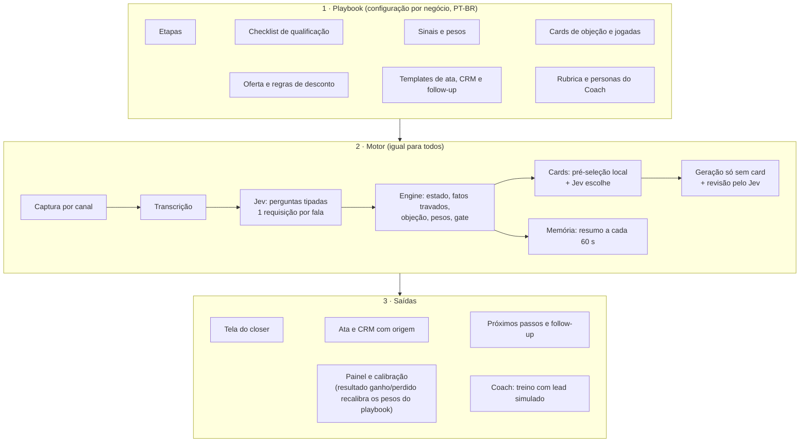
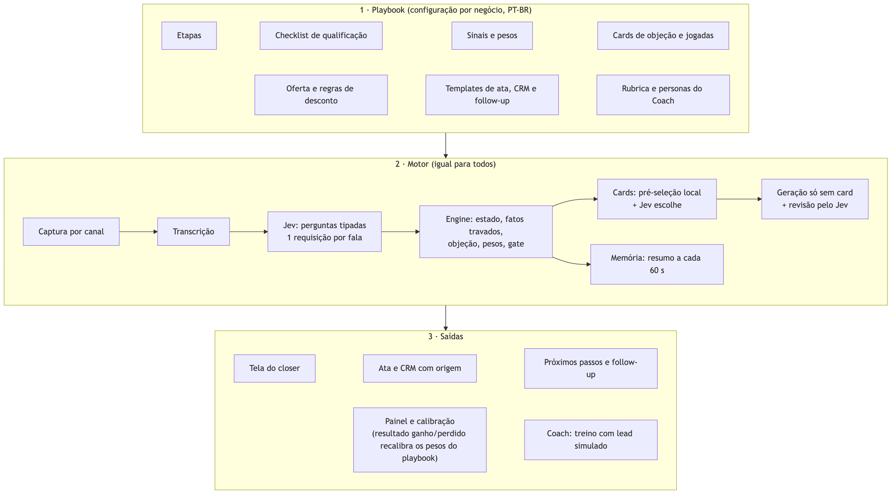
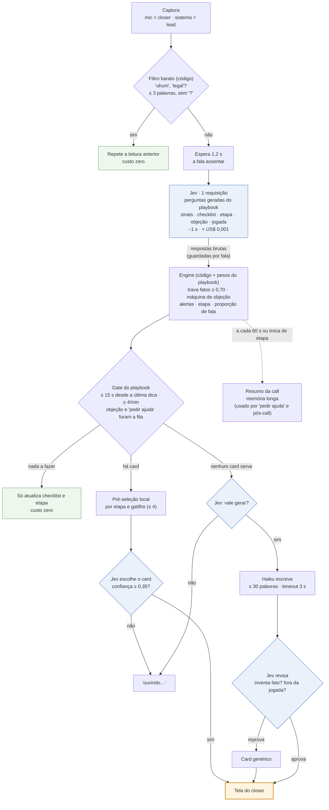
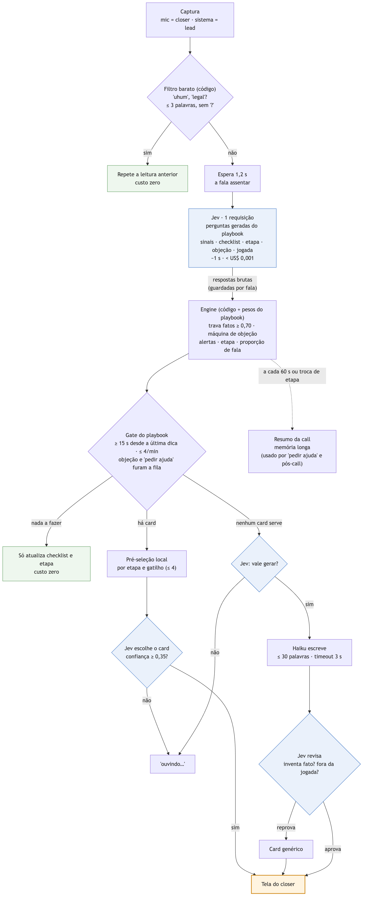
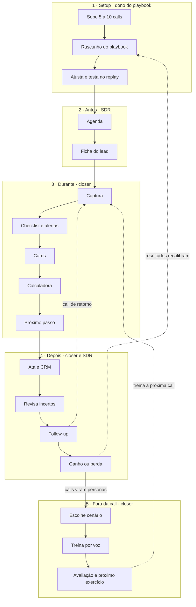
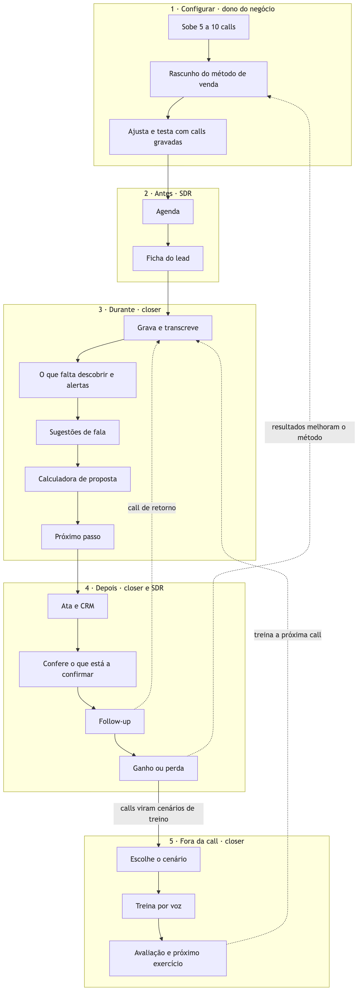
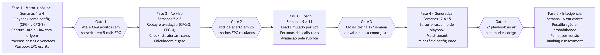

# Notas técnicas — Sales Copilot

> Rascunho técnico separado do PRD em 14/11/2026. Não faz parte do levantamento de requisitos; serve de referência para a fase de solução.
> Termos: "card" = sugestão de fala; "playbook" = método de venda; "Jev" = modelo barato que classifica as falas; "gate" = regra que limita quantas sugestões aparecem.


## Resumo

O Sales Copilot é um copiloto de vendas consultivas **genérico**: um motor único que ajuda o closer durante a call e automatiza tudo o que vem depois. Cada negócio entra como um **playbook configurável**, sem mudar código. O produto junta as duas referências pesquisadas: o **motor de sinais** do playbook-sales-copilot, barato e auditável, e o **produto de ciclo completo** do Deal Advisor (captura, cards, memória, pós-call e coach). A mentoria EPC/MEPC é o primeiro playbook e o piloto que valida o motor.

Referências: [análise do playbook-sales-copilot](../pesquisas/analise-playbook-sales-copilot.md) · [análise do Deal Advisor](../pesquisas/analise-deal-advisor-kelvin-cleto.md) · atas das 12 sessões em `pesquisas/videos/Diagnosticos/`.

## Contexto e problema

As duas referências resolvem metades diferentes do problema, e nenhuma é reaproveitável como está:

| | playbook-sales-copilot | Deal Advisor | O que o nosso produto pega |
| --- | --- | --- | --- |
| Motor ao vivo | Jev responde ~40 perguntas tipadas numa requisição; pesos e estado no código | 3 chamadas ao Jev + GPT-5.4 quando não há card | Motor do playbook (1 requisição, código decide) |
| Texto da dica | 3 frases prontas por jogada + Haiku opcional | 72 cards, pré-seleção local, Jev escolhe; gera só se nenhum serve | Cards do Deal Advisor, geração como último recurso |
| Contexto longo | Fatos travados + janela de 12 falas | Resumo a cada 60 s | Os dois |
| Captura | Chrome STT / sala WebRTC própria | Recall Desktop SDK + AssemblyAI | Captura por canal, sem bot (padrão do Deal Advisor) |
| Pós-call | Nada | CRM com origem do dado, assessment, coach | Pós-call completo |
| Custo por call | < US$ 0,05 | ~US$ 2,50 (84% das gerações descartadas) | < US$ 0,30 |
| Customização | Playbook **chumbado no código**, em inglês (`constants.py`) | Fechado, preso ao ecossistema Acelera | **Playbook como configuração**, em PT-BR |

O ponto central: nos dois sistemas, **o conhecimento do negócio está misturado com o motor**. Etapas, perguntas, pesos, objeções, frases e oferta estão no código. Trocar de negócio exige reescrever o sistema. O nosso produto separa as duas coisas.

### O que o piloto (mentoria EPC, 12 sessões de 05 a 13/11/2026) mostrou

O piloto é a prova de que o motor precisa ser configurável, porque cada item abaixo depende de dados do negócio:

- **Dinheiro trava 8 de 12 calls** (parcela, limite do cartão, caixa do mês). Isso pede **cards de objeção** do negócio.
- **O preço mudou entre calls.** O plano de 6 meses saiu como R$ 7.000, 6x R$ 1.100 (= R$ 6.600) e R$ 12.000. Isso pede uma **tabela de oferta e uma calculadora** configuradas.
- **O decisor estava fora da call em 4 casos.** O Alexandre desistiu depois de pagar R$ 2.000. Isso pede um **checklist de qualificação** com alerta.
- **Follow-up se perdeu:** um lead vencido desde 09/11 e dois sem data. Isso pede **próximos passos com dono e data**.
- **Dados incompletos:** origem ausente em 3 fichas e 3 gravações sem a abertura. Isso pede um **template de CRM** e captura automática.

Resultado da semana: 2 fechamentos com pagamento (Bruno R$ 6.000, Jefersson R$ 10.000), 1 plano escolhido com sinal pendente (Rick), 1 venda desfeita (Alexandre) e 8 em aberto ou adiadas.

## Objetivos e métricas de sucesso

1. **Produto:** colocar um segundo negócio para funcionar só com configuração, sem mudar código.
2. **Resultado no piloto:** subir a conversão e zerar leads esquecidos.
3. **Custo:** manter o custo do motor do playbook, com a experiência do Deal Advisor.

| Métrica | Base | Meta |
| --- | --- | --- |
| Tempo para configurar um playbook novo (etapas, checklist, cards, oferta) | n/a (exige código) | < 1 dia, sem desenvolvedor |
| Playbooks rodando em produção | 0 | 2 (EPC + 1 negócio diferente) |
| Fechamento com pagamento por sessão (piloto EPC) | 2 de 12 (17%) | 30% em 60 dias |
| Leads com próximo passo datado ao fim da call | 9 de 12 | 100% |
| Follow-ups vencidos sem ação | 1 | 0 |
| Proposta com valores conferidos pela calculadora | erro de R$ 400 em 1 call | 100% |
| Tempo entre o fim da call e o CRM atualizado | manual, dias depois | < 10 min, só revisão |
| Custo de IA por call de 60 min | — | < US$ 0,30 |
| Gerações de texto descartadas (Deal Advisor: 84%) | — | < 20% |

## Personas

| Persona | Papel | O que precisa |
| --- | --- | --- |
| **Dono do playbook** (gestor comercial, infoprodutor, mentor) | Configura o método de venda: etapas, perguntas, objeções, oferta | Editar o playbook sem programar, testar com calls antigas e ver o que funciona |
| **Closer** (no piloto: Rodrigo) | Conduz a call no Meet, apresenta e negocia | Saber o que falta qualificar, ter a resposta para a objeção e uma proposta sem erro, sem tirar o olho do lead |
| **SDR / back-office** (no piloto: Luana) | Agenda, faz follow-up e cuida de contrato e cobrança | Contexto antes da call, próximos passos com dono e data, dados prontos para contrato |

Mercado-alvo inicial: vendas consultivas high-ticket no Brasil, feitas por call de 30 a 90 min (mentorias, consultorias, serviços B2B, infoprodutos). É o mesmo perfil atendido pelas duas referências.

## Arquitetura: motor genérico + playbook configurável





Princípio herdado do playbook-sales-copilot: **o modelo classifica, o código decide**, e o que o código usa para decidir vem do playbook. Mudar o comportamento é mudar um coeficiente ou um card, não um prompt.

### Fluxo ao vivo (a cada fala)

```
Captura (mic = closer, sistema = lead)
   │ fala transcrita
   ▼
Filtro barato (código) ── "uhum", "legal", "perfeito" (≤ 3 palavras, sem "?") ──► repete a leitura anterior, custo zero
   │ fala com conteúdo
   ▼
Espera 1,2 s a fala assentar (o lead pode continuar)
   │
   ▼
Jev · 1 requisição com as perguntas geradas do playbook          (~1 s, < US$ 0,001)
   • sinais da fala (compra, compromisso, objeção, desengajamento…)
   • itens do checklist (fatos)  • etapa  • tipo de objeção  • próxima jogada
   │ respostas brutas (guardadas por fala)
   ▼
Engine (código + pesos do playbook)
   • trava fatos com confiança ≥ 0,70 → checklist
   • abre/fecha/expira objeção (máquina de estados)
   • dispara alertas (ex.: decisor ausente)
   • atualiza etapa e proporção de fala
   │
   ▼
Gate (regras do playbook): ≥ 15 s desde a última dica, ≤ 4/min; objeção e "pedir ajuda" furam a fila
   │
   ├── nada a fazer ──────────────────────────────► só atualiza checklist e etapa (custo zero)
   │
   ├── há card ──► pré-seleção local por etapa e gatilho (≤ 4) ──► Jev escolhe o card
   │                                                                   │
   │                                         confiança < 0,35 ──► "ouvindo…"
   │                                                                   ▼
   │                                                             Tela do closer
   │
   └── nenhum card serve ──► Jev: "vale gerar?" ── não ──► "ouvindo…"
                                 │ sim
                                 ▼
                           Haiku escreve (≤ 30 palavras, timeout 3 s)
                                 ▼
                           Jev revisa (inventa fato? fora da jogada?) ── reprova ──► card genérico
                                 │ aprova
                                 ▼
                           Tela do closer

Em paralelo, a cada 60 s ou a cada troca de etapa: resumo da call (memória longa), lido pelo "pedir ajuda" e pelo pós-call.
```

O mesmo fluxo em Mermaid:





A diferença para o Deal Advisor está no passo "vale gerar?". Ele vem **antes** de pagar a geração, não depois, e por isso a meta de gerações descartadas é < 20% (contra 84% no Deal Advisor).

### O que um playbook contém

| Bloco | Conteúdo | Exemplo no piloto EPC |
| --- | --- | --- |
| Etapas | Lista ordenada com descrição, `o que é` e `o que não é` (vira o `choice` de etapa no Jev) e probabilidade base | Abertura → Diagnóstico → Método EPC → Garantias → Oferta → Negociação → Próximo passo |
| Checklist de qualificação | Itens com critério verdadeiro/falso, exemplos em PT e pergunta pronta | Renda atual, meta, prazo, inglês, horas/semana, quem decide, orçamento e cartão, mentorias anteriores |
| Sinais | Perguntas sim/não e scores por fala, com peso e de quem é a fala (lead/closer) | Sinal de compra, compromisso, desengajamento, "decide com o cônjuge" |
| Objeções | Tipos com critério de detecção | Parcela/cartão, sem renda, timing, comparando concorrentes, cônjuge, falta de tempo |
| Cards | Texto revisado por humano, com etapa, gatilho, objeção e pergunta de follow-up | "Se eu montar a entrada para depois do seu salário, o que mais te impede?" |
| Oferta | Planos, preços, parcelas, entrada, descontos permitidos e limite de desconto | 3 meses / 6 meses / 12 meses, Pix de compromisso, desconto máx. a definir |
| Templates | Campos de ata, de CRM (obrigatórios e opcionais) e modelos de follow-up | Ficha atual de CRM (perfil, situação, meta, dores, oferta, objeções, próximo passo) |
| Regras de gate | Intervalo mínimo entre dicas, dicas por minuto, o que fura a fila | 15 s, 4/min, objeção fura a fila |
| Rubrica de avaliação (Coach) | Critérios por etapa, com o que é bom, médio e ruim | Diagnóstico: quantificou a dor e a meta? Oferta: confirmou o decisor antes do preço? |
| Personas de treino | Perfis de lead montados a partir das calls reais: situação, jeito de falar, dores, objeções e critério de abandono | Dev sênior sem renda cotando outra mentoria; dev casado que decide com a esposa |

O playbook é versionado. Toda call registra a versão usada, para comparar resultados entre versões.

## Escopo do MVP

### Plataforma e configuração

| ID | Requisito | Prioridade | Origem |
| --- | --- | --- | --- |
| CFG-1 | Playbook como arquivo de configuração versionado (YAML/JSON) com os blocos acima; o motor não tem nada de negócio no código | P0 | Limitação nº 3 do playbook-sales-copilot (playbook chumbado) |
| CFG-2 | Gerador de perguntas do Jev a partir do playbook: etapas → `choice`, checklist → `noul` com memória, sinais → `noul`/`score`, cards → `choice` entre candidatos | P0 | Fan-out em 1 requisição do playbook-sales-copilot |
| CFG-3 | Replay: rodar uma call gravada contra uma versão do playbook e ver etapas, sinais, cards e checklist ao longo do tempo | P0 | Testar um playbook antes de usar ao vivo |
| CFG-4 | Conjunto de avaliação por playbook (trechos rotulados) com relatório de acerto por pergunta | P0 | Nenhuma das referências mede em PT-BR |
| CFG-5 | Editor visual de playbook (formulários em vez de YAML) | P1 | Dono do playbook sem programar |
| CFG-6 | Assistente que rascunha um playbook a partir de 5 a 10 calls gravadas (etapas, objeções reais, cards com falas reais) | P1 | Acelera o onboarding de um negócio novo |
| CFG-7 | Multi-tenant: cada negócio com os próprios playbooks, usuários e dados isolados | P1 | Pré-requisito do segundo cliente |

### Durante a call

| ID | Requisito | Prioridade | Origem |
| --- | --- | --- | --- |
| LIVE-1 | Captura automática do Meet desde o primeiro segundo, com falante separado por canal (microfone = closer, sistema = lead), sem bot | P0 | 3 gravações do piloto sem a abertura; Recall Desktop SDK do Deal Advisor |
| LIVE-2 | Checklist de qualificação do playbook marcado sozinho, com fatos travados | P0 | Fatos com memória do playbook-sales-copilot |
| LIVE-3 | Alertas configuráveis (no piloto: "decisor ausente") com a jogada sugerida | P0 | 4 casos de cônjuge fora da call |
| LIVE-4 | Etapa atual e objeção aberta (máquina de estados), conforme o playbook | P0 | Playbook-sales-copilot |
| LIVE-5 | Cards: pré-seleção local por etapa e gatilho (no máximo 4), escolha pelo Jev, "ouvindo…" quando a confiança é baixa | P0 | Deal Advisor |
| LIVE-6 | Calculadora de proposta com a oferta do playbook, respeitando o limite de desconto | P0 | Erro de R$ 400 e preços diferentes no piloto |
| LIVE-7 | Gate com regras do playbook | P0 | Deal Advisor |
| LIVE-8 | Modo discreto, fora do compartilhamento de tela | P0 | Closer apresenta com tela compartilhada |
| LIVE-9 | Geração de texto só quando nenhum card serve, precedida de "vale gerar?" (Jev) e revisada pelo Jev antes de aparecer | P1 | Corrige os 84% descartados do Deal Advisor |
| LIVE-10 | "Pedir ajuda" com resposta a partir do resumo e dos dados da call | P1 | Deal Advisor |
| LIVE-11 | Probabilidade de fechamento | P2 | Só com pesos calibrados (POS-7) |

### Depois da call

| ID | Requisito | Prioridade | Origem |
| --- | --- | --- | --- |
| POS-1 | Ata pelo template do playbook, em até 10 min | P0 | Substitui o passo manual OBS → skill do piloto |
| POS-2 | Ficha de CRM pelo template, com cada dado ligado ao trecho e minuto de origem e campos "a confirmar" destacados | P0 | "Dados com origem" do Deal Advisor |
| POS-3 | Próximos passos com dono e data, lembretes e lista de vencidos | P0 | Follow-ups perdidos no piloto |
| POS-4 | Rascunho de follow-up (WhatsApp/e-mail) com a proposta conferida | P1 | Back-office do piloto |
| POS-5 | Pipeline com status e temperatura | P1 | Hoje o status vive em arquivos de texto |
| POS-6 | Painel por playbook e versão: conversão, objeções mais frequentes, cards usados, taxa de "nenhum card cabe" | P1 | Mostra onde escrever cards novos |
| POS-7 | Registro do resultado final ligado às respostas brutas da call, com recalibração dos pesos (regressão logística) | P1 | Pesos chutados à mão nas duas referências |
| POS-8 | Exportar para CRMs externos (webhook; depois integrações nativas) | P2 | Cada negócio usa um CRM |

### Treinamento (Coach)

O closer treina por voz com um lead simulado, montado a partir das calls reais do próprio negócio, e recebe uma avaliação pela rubrica do playbook. O módulo vem do Deal Advisor e aqui também é genérico: personas e rubrica saem do playbook.

| ID | Requisito | Prioridade | Origem |
| --- | --- | --- | --- |
| COACH-1 | Três modos: refazer uma call real ("uma call minha"), lead aleatório misturando perfis, dores e objeções das calls, e lead gerado a partir de uma descrição | P0 | Deal Advisor |
| COACH-2 | Treinar a call inteira ou uma etapa só (ex.: só a negociação), com dificuldade Receptivo, Realista ou Exigente; sessão de até 10 min | P0 | Deal Advisor |
| COACH-3 | Lead simulado por voz em PT-BR, com critério de abandono (encerra a call se o closer for agressivo ou ignorar a objeção) | P0 | Deal Advisor |
| COACH-4 | Avaliação pela rubrica do playbook: nota ("Sem nota" quando há pouca evidência), "o que funcionou" e "o que melhorar" com citações, e um próximo exercício | P0 | Deal Advisor |
| COACH-5 | O mesmo motor ao vivo roda no treino: checklist, cards e alertas aparecem como na call real | P1 | Treinar com a ferramenta que vai usar |
| COACH-6 | Exercícios gerados a partir das objeções mais frequentes do painel (POS-6), que no piloto são parcela/cartão e cônjuge | P1 | Treinar onde as calls reais travam |
| COACH-7 | Histórico de notas por closer e por critério; ranking entre closers | P2 | O Deal Advisor ainda não tem ("falta a gamificação") |
| COACH-8 | Botão "Simular" em cada call gravada, que a transforma em cenário de treino | P1 | Deal Advisor |

No piloto EPC, o primeiro exercício é a negociação com o lead que "decide com a esposa" e com o que "não tem limite no cartão": juntos, os dois perfis explicam 6 das 12 calls.

## Fora de escopo (por enquanto)

- Assessment em slides gerado a partir da call (Deal Advisor). Candidato à fase 5.
- Zoom e Teams: o MVP atende o Google Meet.
- Envio automático de mensagens, cobranças ou contratos: o produto prepara e um humano envia.
- Marketplace de playbooks prontos.

## Jornada





## Requisitos não funcionais

| Tema | Requisito |
| --- | --- |
| Idioma | Playbooks e perguntas em PT-BR (com suporte a outros idiomas por playbook) |
| Latência | Card na tela em até 3 s após a fala |
| Custo | < US$ 0,30 por call de 60 min; log de custo por chamada e por playbook desde o primeiro dia |
| Contexto longo | Fatos travados + resumo a cada 60 s ou a cada troca de etapa, para calls de até 95 min |
| Confiabilidade | Se a IA cair, captura e transcrição continuam; o pós-call roda depois |
| Isolamento | Dados, playbooks e chaves separados por negócio |
| Privacidade (LGPD) | Aviso de gravação ao lead; relay único no servidor (nenhuma chave no cliente); fornecedores com retenção zero quando possível; exclusão de dados por lead |
| Auditoria | Respostas brutas do Jev guardadas por fala e versão do playbook, para recalcular e recalibrar sem chamar a IA de novo |

Fornecedores: captura (Recall Desktop SDK ou captura própria), transcrição (ElevenLabs Scribe ou AssemblyAI), Jev (classificação), Claude Haiku (texto curto), Claude (ata, CRM e rascunho de playbook).

## Riscos e perguntas em aberto

| Risco | Impacto | Mitigação |
| --- | --- | --- |
| Configuração genérica demais fica difícil de usar | Ninguém além de nós consegue montar um playbook | CFG-6 (rascunho a partir de calls) + playbook EPC como modelo |
| Over-engineering antes de validar valor | Meses de plataforma sem cliente | Construir o motor genérico, mas validar só com o EPC até o Gate 1 |
| Jev erra em PT-BR | Cards e checklist errados | CFG-4: avaliação por playbook antes de ligar o ao vivo |
| Dependência do Jev (endpoint alpha, poucos provedores) | Motor para | Camada de classificação com fallback para Claude Haiku |
| Dicas distraem o closer | Pior condução | Gate configurável e modo só checklist |
| LGPD com vários fornecedores | Risco jurídico | Relay único e lista fechada de fornecedores |

Perguntas em aberto:

- [ ] Modelo de negócio: ferramenta interna para vários closers ou SaaS vendido a outros negócios? Isso muda a prioridade de CFG-5 e CFG-7.
- [ ] Qual é o segundo negócio para validar a generalização (de preferência fora de mentoria)?
- [ ] Captura: comprar (Recall SDK) ou construir? É preciso comparar custo e LGPD.
- [ ] Piloto EPC: qual é a tabela oficial de 3, 6 e 12 meses e qual o limite de desconto?
- [ ] Onde o CRM mora: próprio ou integração com um CRM existente?

## Roadmap

```mermaid
flowchart LR
  F1["Fase 1 · Motor + pós-call<br/>Semanas 1 a 4<br/>Playbook como config (CFG-1, CFG-2)<br/>Captura, ata e CRM com origem<br/>Próximos passos e vencidos<br/>Playbook EPC escrito"]
  G1{{"Gate 1<br/>Ata e CRM aceitos sem<br/>reescrita em 5 calls EPC"}}
  F2["Fase 2 · Ao vivo<br/>Semanas 5 a 8<br/>Replay e avaliação (CFG-3, CFG-4)<br/>Checklist, alertas, cards<br/>Calculadora e gate"]
  G2{{"Gate 2<br/>85% de acerto em 25<br/>trechos EPC rotulados"}}
  F3["Fase 3 · Coach<br/>Semanas 9 a 11<br/>Lead simulado por voz<br/>Personas das calls reais<br/>Avaliação pela rubrica"]
  G3{{"Gate 3<br/>Closer treina 1x/semana<br/>e avalia a nota como justa"}}
  F4["Fase 4 · Generalizar<br/>Semanas 12 a 15<br/>Editor e rascunho de playbook<br/>Multi-tenant<br/>2º negócio configurado"]
  G4{{"Gate 4<br/>2º playbook no ar<br/>sem mudar código"}}
  F5["Fase 5 · Inteligência<br/>Semana 16 em diante<br/>Recalibração e probabilidade<br/>Painel por versão<br/>Ranking e assessment"]
  F1 --> G1 --> F2 --> G2 --> F3 --> G3 --> F4 --> G4 --> F5
```





O motor nasce genérico desde a fase 1 (nada de negócio no código), mas só o playbook EPC roda até o Gate 3. O Coach vem antes da generalização porque reaproveita as calls gravadas na fase 1 e o motor da fase 2. A generalização é validada de fato no Gate 4, com um segundo negócio. As semanas contam a partir do início do desenvolvimento.

Próximos passos:

- [ ] Definir o modelo de negócio (interno ou SaaS) e escolher o segundo negócio
- [ ] Escrever o schema do playbook e portar o `constants.py` do playbook-sales-copilot para ele, em PT-BR
- [ ] Escrever o playbook EPC a partir das 12 calls (etapas, checklist, 6 objeções, cards, oferta)
- [ ] Rotular 25 trechos das 12 calls para o conjunto de avaliação
- [ ] Testar a captura do Meet por canal numa call real
