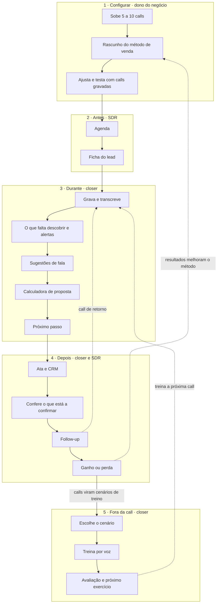
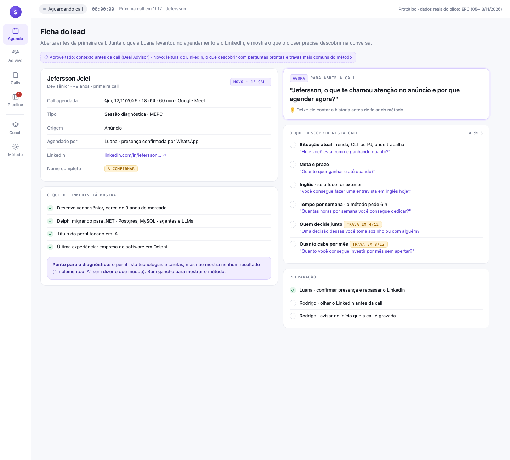
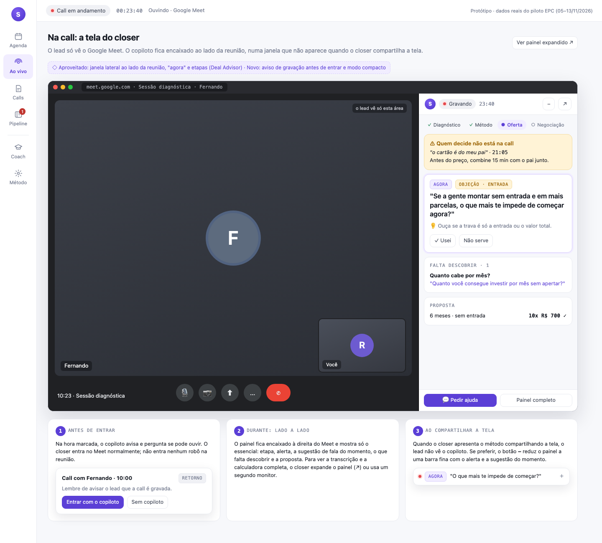
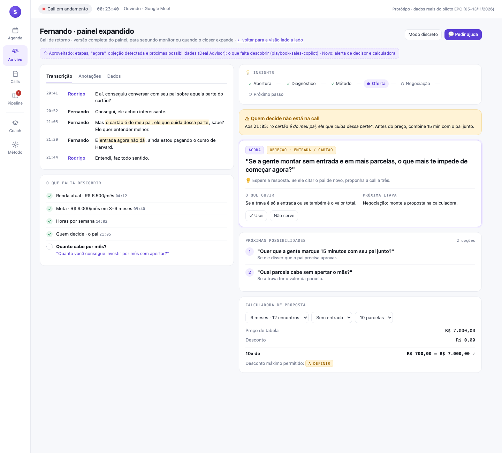
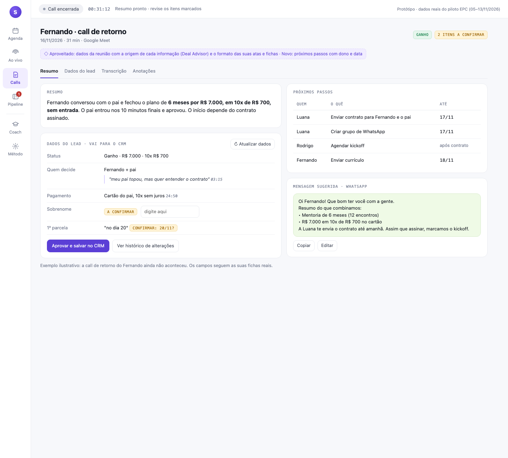
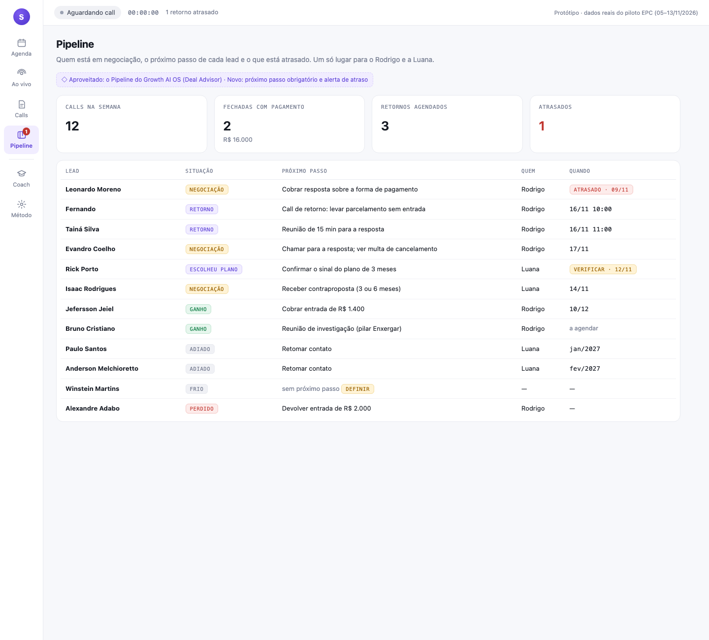
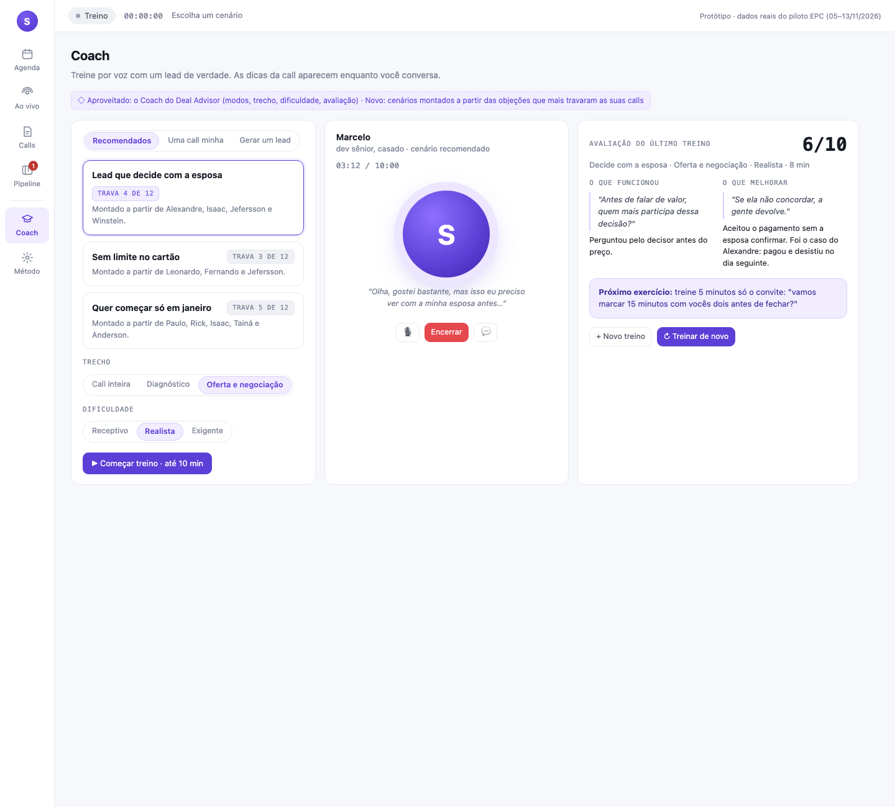
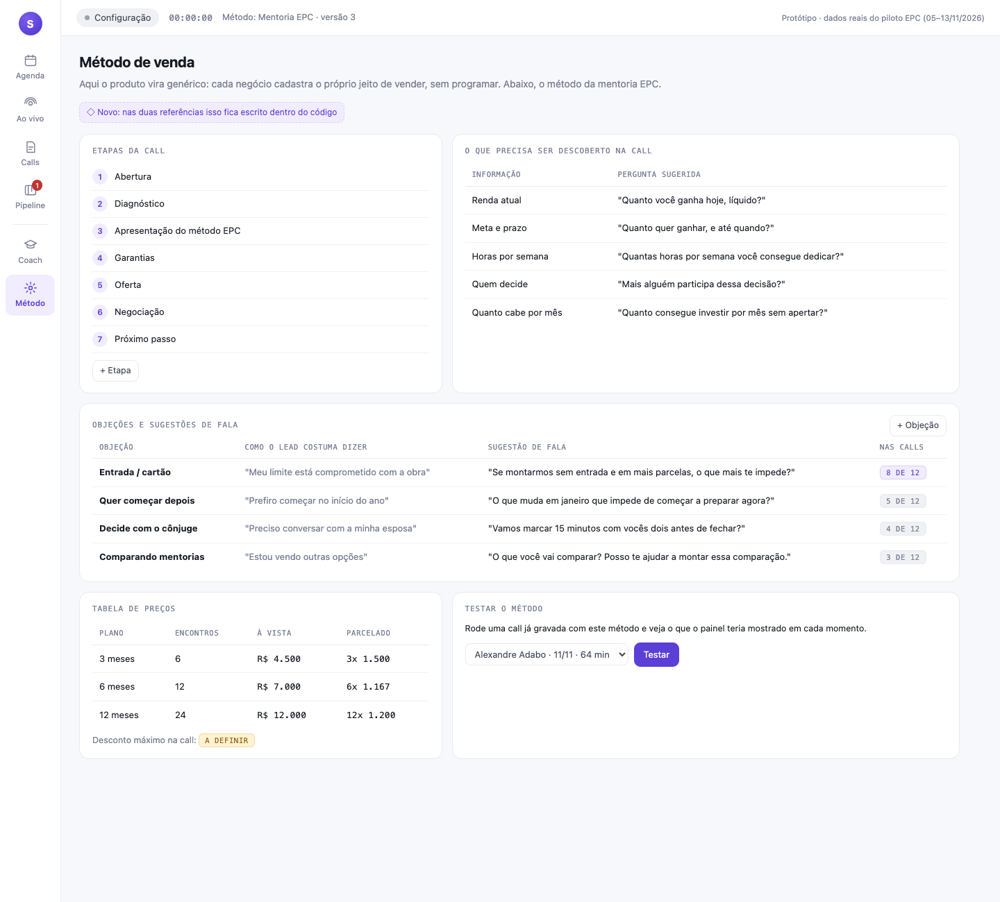

# PRD — Sales Copilot

> Este documento descreve **o que** o produto precisa fazer e **para quem**, em linguagem de negócio. As decisões de **como** construir (modelos de IA, arquitetura, custos) ficam em [notas-tecnicas.md](notas-tecnicas.md) e só serão fechadas depois deste levantamento.
>
> Protótipo navegável das telas: [prototipos/prototipo-sales-copilot.html](prototipos/prototipo-sales-copilot.html) (abra no navegador). Imagens das telas em [prototipos/](prototipos/).

## 1. Em uma frase

Um assistente para quem vende por call, que **ajuda durante a conversa** (o que perguntar, como responder objeções, quanto cobrar) e **faz o trabalho de depois** (resumo, ficha do lead, próximos passos e follow-up). Também **treina o vendedor** com simulações. Cada negócio cadastra o próprio jeito de vender. A mentoria EPC é o primeiro negócio a usar e serve de piloto.

## 2. Glossário

| Termo | O que significa aqui |
| --- | --- |
| **Lead** | A pessoa que está sendo atendida na call (o potencial cliente). |
| **Closer** | Quem conduz a call e fecha a venda. No piloto, o Rodrigo. |
| **SDR / back-office** | Quem agenda, prepara o lead e cuida do pós-venda (follow-up, contrato, cobrança). No piloto, a Luana. |
| **Sessão diagnóstica** | A call de venda da mentoria (30 a 95 min, no Google Meet). |
| **Método de venda** | O "jeito de vender" de um negócio, cadastrado no produto: etapas da call, o que precisa ser descoberto, objeções comuns, sugestões de fala e tabela de preços. Cada negócio tem o seu. *(Nas referências técnicas aparece como "playbook".)* |
| **Etapas da call** | As fases da conversa, na ordem. No piloto: Abertura → Diagnóstico → Apresentação do método → Garantias → Oferta → Negociação → Próximo passo. |
| **O que falta descobrir** | A lista de informações que o closer precisa ter antes da oferta (renda, meta, prazo, quem decide, quanto cabe por mês…). O produto marca sozinho o que já foi dito e mostra o que ainda falta. |
| **Objeção** | Um motivo que o lead dá para não fechar agora ("preciso falar com a minha esposa", "não tenho limite no cartão"). |
| **Sugestão de fala** | Uma frase curta e pronta que aparece na tela para o closer usar naquele momento, por exemplo para responder uma objeção. As sugestões são escritas e aprovadas pelo próprio negócio. *(Nas referências aparece como "card".)* |
| **Alerta** | Um aviso em destaque quando algo importante acontece na call, por exemplo "quem decide não está na call". |
| **Calculadora de proposta** | Monta a proposta (plano, entrada, parcelas, desconto) com a tabela de preços oficial e confere a conta. |
| **Ficha do lead** | O registro do lead no CRM: perfil, situação, meta, objeções, proposta, status e próximos passos. |
| **Próximo passo** | Uma ação combinada, com dono e data (ex.: "Luana envia o contrato até 17/11"). |
| **Follow-up** | O contato depois da call para dar continuidade à negociação. |
| **Coach / treino** | Simulação de call por voz com um lead fictício, montado a partir das calls reais, seguida de uma avaliação. |
| **Piloto** | O primeiro uso real do produto: a mentoria EPC/MEPC do Rodrigo. |

## 3. Problema

Analisamos as 12 sessões diagnósticas da mentoria EPC de 05 a 13/11/2026 e dois produtos de referência.

**O que aconteceu nas 12 calls:** 2 fecharam com pagamento (R$ 16.000), 1 escolheu plano e está pendente, 1 pagou entrada e desistiu no dia seguinte, e 8 ficaram em aberto ou adiadas.

| O que trava as vendas | Quantas calls | Exemplo |
| --- | --- | --- |
| Dinheiro no momento (entrada, parcela, limite do cartão) | 8 de 12 | Leonardo: "limite do cartão comprometido com a obra" |
| Quer começar depois ("no início do ano") | 5 de 12 | Paulo já tinha decidido fechar só em 2027 |
| Quem decide não está na call (esposa, pai) | 4 de 12 | Alexandre pagou R$ 2.000 e desistiu após falar com a esposa |
| Está comparando com outras mentorias | 3 de 12 | Evandro cotando outra mentoria |

**E o que se perde depois da call:**

- **Preço diferente a cada call.** O plano de 6 meses foi oferecido como R$ 7.000, como 6x R$ 1.100 (que dá R$ 6.600) e como R$ 12.000.
- **Follow-up esquecido.** Leonardo ficou de responder em 09/11 e ninguém cobrou; Winstein e Paulo ficaram sem próximo passo.
- **Ficha do lead incompleta.** A origem do lead faltou em 3 calls; nomes e valores ficaram "a confirmar".
- **Trabalho manual depois de toda call.** Gravar, transcrever, escrever a ata e montar a ficha do CRM.

**Nas referências:** o [playbook-sales-copilot](../pesquisas/analise-playbook-sales-copilot.md) é barato e transparente, mas a tela é confusa e difícil de usar, e não faz nada depois da call. O [Deal Advisor](../pesquisas/analise-deal-advisor-kelvin-cleto.md) tem a melhor experiência (visual limpo, ciclo completo e treino), mas é fechado e serve só ao negócio do Kelvin. **Nenhum dos dois deixa outro negócio cadastrar o próprio método de venda.**

## 4. Objetivos

1. **Vender mais no piloto:** passar de 17% (2 de 12) para 30% de calls fechadas com pagamento, em 60 dias de uso.
2. **Não perder ninguém:** todo lead sai da call com um próximo passo com data, e nenhum follow-up fica atrasado sem alguém ver.
3. **Acabar com o trabalho manual pós-call:** resumo e ficha do lead prontos até 10 minutos depois da call; o closer só confere.
4. **Proposta sempre certa:** zero erro de conta e preço sempre de acordo com a tabela.
5. **Servir a outros negócios:** um segundo negócio, diferente da mentoria, consegue usar o produto só cadastrando o próprio método de venda.

## 5. Quem usa

| Pessoa | O que faz | O que mais precisa |
| --- | --- | --- |
| **Closer** (Rodrigo) | Conduz a call, apresenta e negocia | Saber o que perguntar, ter a resposta para a objeção e acertar a proposta, sem tirar os olhos do lead |
| **SDR / back-office** (Luana) | Agenda, prepara o lead, faz follow-up, contrato e cobrança | Saber o que foi combinado, com quem e até quando |
| **Dono do negócio** (Rodrigo, no piloto) | Define o jeito de vender | Cadastrar e ajustar o método sem programar, e ver o que está funcionando |

## 6. Como funciona: a jornada

Fonte Mermaid da jornada

## 7. Telas e requisitos

O visual segue o do Deal Advisor (claro, menu lateral de ícones, destaque em roxo), não o do playbook-sales-copilot. Cada tela abaixo tem um protótipo com dados reais do piloto. Prioridade: **Essencial** (sem isso não há produto), **Importante** (logo em seguida), **Depois**.

### 7.1 Ficha do lead (antes da call)

Exemplo: a ficha do Jefersson como estaria antes da primeira call (12/11, 18h, MEPC). Só aparece o que se sabia antes da conversa: o anúncio de origem, o agendamento feito pela Luana e o LinkedIn.

| # | Requisito | Prioridade | Por quê |
| --- | --- | --- | --- |
| A1 | A SDR registra o lead com origem, LinkedIn e o que já sabe; a origem é obrigatória | Essencial | Origem faltou em 3 de 12 fichas |
| A2 | A ficha mostra o que descobrir na call, com a pergunta pronta para cada item e um destaque nas travas mais comuns (decisor, orçamento) | Essencial | Decisor e orçamento só apareciam na hora da oferta |
| A3 | A ficha resume o que o LinkedIn já mostra e aponta um gancho para o diagnóstico | Importante | O closer comenta o LinkedIn em toda call; o cadastro do Fernando dizia 3–4 anos de experiência, mas ele tinha cerca de 20 |
| A4 | Lista de preparação (presença confirmada, LinkedIn repassado, aviso de gravação) | Importante | 3 gravações começaram com a call em andamento |
| A5 | Em calls de retorno, a ficha também mostra o histórico: o que foi oferecido, onde travou e o que foi combinado | Essencial | Fernando, Tainá e Evandro têm retorno marcado |
| A6 | Sugestão de como abrir a call | Depois | |

### 7.2 Painel durante a call

**Na call: a tela do closer.** O lead só vê o Google Meet. O painel do copiloto fica encaixado à direita da reunião e mostra só o essencial: etapa, alerta, sugestão de fala do momento, o que falta descobrir e a proposta. Antes de entrar, o copiloto avisa da call e lembra o aviso de gravação. Quando o closer compartilha a tela, o painel não aparece para o lead e pode ser reduzido a uma barra fina.

**Painel expandido.** Esta é a versão completa, com transcrição, próximas possibilidades e calculadora. Serve para um segundo monitor ou para quando o closer expande o painel lateral.

| # | Requisito | Prioridade | Por quê |
| --- | --- | --- | --- |
| D1 | A call é gravada e transcrita do início ao fim, sem bot na reunião, separando o que o closer e o lead falam | Essencial | 3 gravações do piloto começaram com a call em andamento |
| D0 | Na hora da call, o copiloto avisa, lembra o aviso de gravação e o closer escolhe entrar com ou sem ele | Essencial | Evitar gravações que começam no meio da call |
| D2 | O painel fica ao lado da janela do Meet, numa janela própria que o lead não vê quando o closer compartilha a tela; pode ser compactado numa barra ou expandido | Essencial | O closer apresenta o método compartilhando a tela |
| D3 | Mostra em que etapa a call está | Essencial | Orientar o closer e saber onde as calls longas se estendem |
| D4 | Marca sozinho o que já foi descoberto (com o minuto em que foi dito) e mostra a pergunta pronta para o que falta | Essencial | Decisor e orçamento só apareciam na hora da oferta |
| D5 | Alerta quando quem decide não está na call, com a sugestão do que fazer | Essencial | 4 de 12 calls; caso Alexandre |
| D6 | Quando o lead faz uma objeção, mostra a sugestão de fala do método de venda, e o closer marca "usei" ou "não serve" | Essencial | As 4 travas cobrem todas as calls não fechadas |
| D7 | Calculadora de proposta com a tabela oficial, conferindo a conta e o desconto máximo | Essencial | Preço diferente a cada call; erro de R$ 400 |
| D8 | No máximo uma sugestão nova a cada 15 segundos, para não poluir a tela; objeções têm prioridade | Essencial | O closer não pode se distrair |
| D9 | Botão "pedir ajuda" para situações sem sugestão pronta | Importante | |
| D10 | Mostra quanto tempo o closer está falando versus o lead | Depois | |
| D11 | Chance de fechamento ao vivo | Depois | Só quando houver histórico suficiente de vendas ganhas e perdidas |

### 7.3 Resumo e ficha do lead (depois da call)

| # | Requisito | Prioridade | Por quê |
| --- | --- | --- | --- |
| P1 | Resumo da call e ficha do lead prontos até 10 minutos depois, no formato das atas e fichas atuais | Essencial | Acaba com o trabalho manual pós-call |
| P2 | Cada informação da ficha mostra o trecho e o minuto de onde veio; o que não ficou claro aparece como "a confirmar" | Essencial | Nomes e valores "a confirmar" nas fichas do piloto |
| P3 | O closer confere, corrige e aprova antes de salvar no CRM | Essencial | Nada vai para o CRM sem revisão humana |
| P4 | Próximos passos com dono e data, que viram lembretes | Essencial | Follow-ups esquecidos |
| P5 | Mensagem de follow-up sugerida para WhatsApp, com a proposta conferida (só sugere; quem envia é a pessoa) | Importante | A Luana faz a maioria dos retornos |

### 7.4 Pipeline

| # | Requisito | Prioridade | Por quê |
| --- | --- | --- | --- |
| L1 | Lista de leads com situação, próximo passo, dono e data | Essencial | Hoje isso vive em arquivos de texto soltos |
| L2 | Destaque para atrasados e para leads sem próximo passo | Essencial | Leonardo atrasado desde 09/11; Winstein sem próximo passo |
| L3 | Resumo da semana: calls, fechamentos, valor fechado, retornos e atrasados | Importante | Acompanhar as metas |
| L4 | Enviar os dados para o CRM que o negócio já usa | Depois | Cada negócio tem o seu CRM |

### 7.5 Coach (treino)

| # | Requisito | Prioridade | Por quê |
| --- | --- | --- | --- |
| C1 | Treinar por voz com um lead simulado, montado a partir das calls reais do negócio | Importante | Praticar sem queimar leads reais |
| C2 | Cenários recomendados a partir das objeções que mais travam as vendas | Importante | No piloto: quem decide com a esposa, sem limite no cartão, quer começar depois |
| C3 | Treinar a call inteira ou só uma etapa (ex.: só a negociação), com dificuldade Receptivo, Realista ou Exigente; até 10 min | Importante | Mesmo formato do Deal Advisor |
| C4 | Refazer uma call real ("uma call minha") | Importante | Treinar a call que foi perdida |
| C5 | O lead simulado encerra a call se o closer for agressivo ou ignorar a objeção | Importante | Treino realista |
| C6 | Avaliação no fim: nota (ou "sem nota" se houve pouco material), o que funcionou e o que melhorar com citações, e um próximo exercício | Importante | |
| C7 | Histórico de notas por closer e ranking | Depois | Faz sentido com mais de um closer |

### 7.6 Método de venda (configuração)

| # | Requisito | Prioridade | Por quê |
| --- | --- | --- | --- |
| M1 | O dono do negócio cadastra etapas, o que precisa ser descoberto (com a pergunta sugerida), objeções, sugestões de fala e tabela de preços com desconto máximo | Essencial | É o que torna o produto genérico |
| M2 | Testar o método com uma call já gravada e ver o que o painel teria mostrado | Importante | Ajustar antes de usar com lead real |
| M3 | Ver quais sugestões de fala foram usadas e quais objeções ficaram sem resposta | Importante | Saber onde escrever sugestões novas |
| M4 | Gerar um rascunho do método a partir de 5 a 10 calls gravadas | Depois | Acelera a entrada de um negócio novo |
| M5 | Vários negócios no mesmo produto, cada um com seus dados separados | Depois | Necessário a partir do segundo negócio |

## 8. Regras de negócio

1. Toda call começa com aviso de gravação ao lead.
2. Nada vai para o CRM sem o closer aprovar.
3. A proposta só pode usar os planos e preços da tabela; descontos acima do limite precisam de confirmação explícita do closer.
4. Todo lead precisa terminar a call com status e próximo passo (ou o motivo de não ter um).
5. O produto sugere mensagens, mas nunca envia mensagens, cobranças ou contratos sozinho.
6. Os dados de um negócio não aparecem para outro.

## 9. Fora do escopo agora

- Apresentação personalizada em slides gerada a partir da call (o "assessment" do Deal Advisor).
- Zoom e Teams: o primeiro foco é o Google Meet, onde acontecem todas as calls do piloto.
- Envio automático de mensagens, cobranças ou contratos.

## 10. Como vamos medir

| Indicador | Hoje (12 calls) | Meta |
| --- | --- | --- |
| Calls fechadas com pagamento | 2 de 12 (17%) | 30% |
| Vendas desfeitas depois do pagamento | 1 | 0 |
| Leads com próximo passo datado ao fim da call | 9 de 12 | 12 de 12 |
| Follow-ups atrasados sem ninguém ver | 1 | 0 |
| Propostas com erro de conta ou fora da tabela | pelo menos 1 | 0 |
| Tempo entre o fim da call e a ficha pronta | manual, dias depois | até 10 min |
| Sugestões marcadas como "usei" | — | a definir depois de 2 semanas de uso |

## 11. Perguntas em aberto (para fechar no levantamento)

**Sobre o produto**
- [ ] É uma ferramenta para uso próprio (vários closers da mentoria) ou um produto para vender a outros negócios?
- [ ] Qual seria o segundo negócio para validar que o produto serve a outros (de preferência fora de mentoria)?
- [ ] Onde a ficha do lead deve ficar: num CRM próprio do produto ou num CRM que vocês já usam? Qual?

**Sobre o piloto (mentoria EPC)**
- [ ] Qual é a tabela oficial de 3, 6 e 12 meses?
- [ ] Qual é o desconto máximo que pode ser dado na call? E o Pix de compromisso entra como regra?
- [ ] Qual é a diferença de oferta entre EPC e MEPC?
- [ ] A Luana vai usar o produto diretamente ou só recebe as tarefas?
- [ ] Quais informações são obrigatórias na ficha do lead?

**Sobre as telas**
- [ ] O painel durante a call mostra o que o closer precisa? O que tirar, o que falta?
- [ ] Durante a call, o closer usa um monitor só (Meet e painel lado a lado) ou dois (painel expandido no segundo)?
- [ ] Ao compartilhar a tela, o painel lateral é suficiente ou é melhor reduzi-lo a uma barra?
- [ ] Quantas sugestões o closer aguenta ver ao mesmo tempo sem se distrair?
- [ ] O treino é usado só pelo Rodrigo ou haverá outros closers?

## 12. Próximos passos do levantamento

- [ ] Rodrigo e Luana navegam pelo protótipo e anotam o que mudar
- [ ] Responder as perguntas em aberto
- [ ] Escrever com o Rodrigo as sugestões de fala para as 4 objeções principais, usando as falas reais das calls
- [ ] Validar a jornada com uma call real (passo a passo, do agendamento ao follow-up)
- [ ] Só depois: abrir as [notas técnicas](notas-tecnicas.md) e decidir como construir
